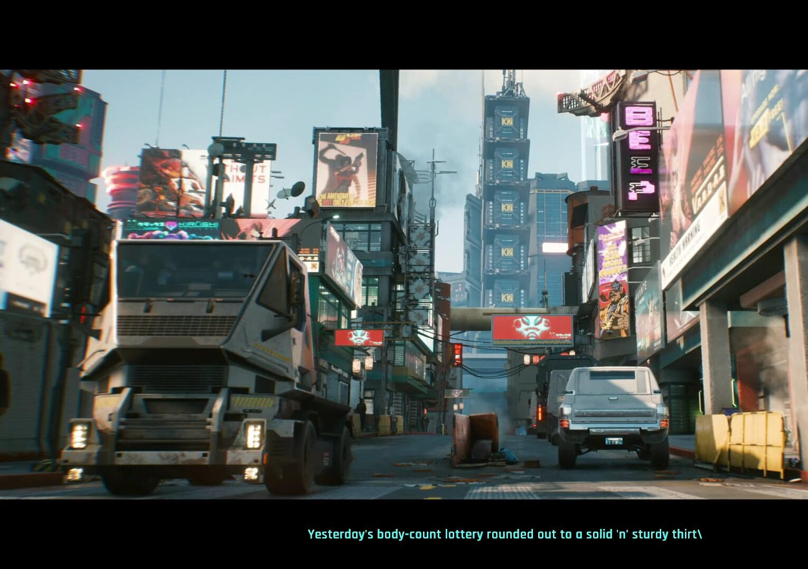
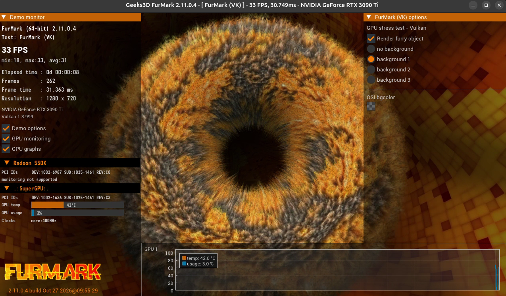
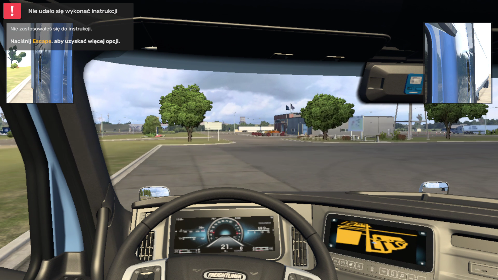
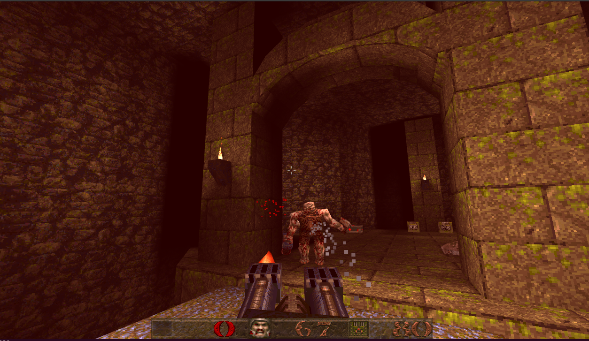
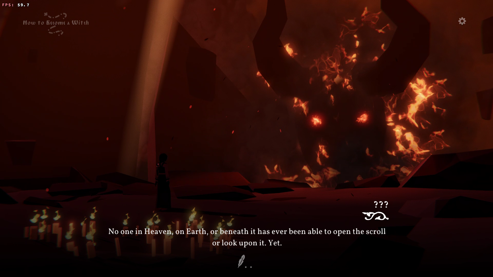
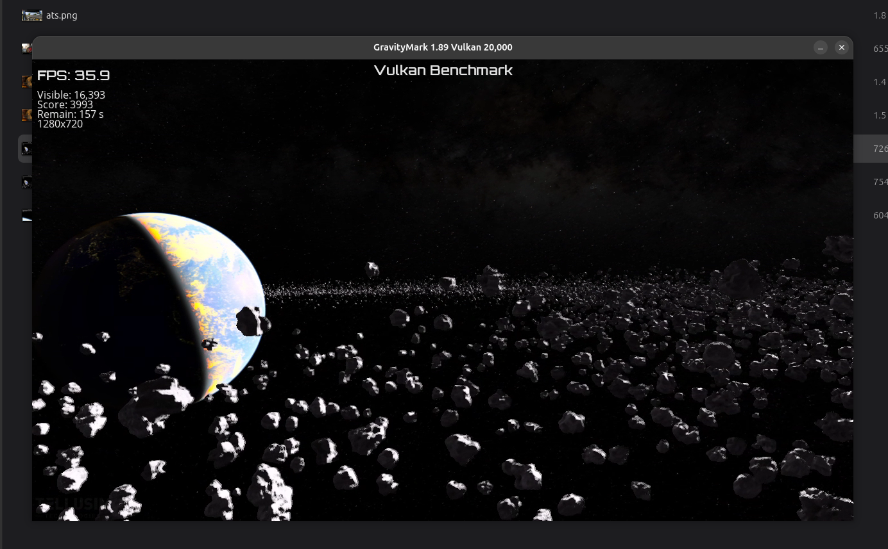

<!-- i18n-switch -->
[English](README.md) · [Polski](README.pl.md) · **Español**
<!-- /i18n-switch -->

# gpu-over-wifi

Comparte una GPU doméstica potente entre tus dispositivos: ejecuta grandes modelos de IA, juega en un portátil débil como si tuviera la tarjeta gráfica potente y deja que el servidor decida quién usa la GPU.

> **Estado: proyecto de investigación temprano.** Las cosas funcionan en el laboratorio, todavía no en el uso diario. Solo Linux por ahora (el cliente Windows está planificado). Resultados por juego: [Mediciones](#measurements) (al final).

## Cyberpunk 2077 en una GPU remota: de 2 FPS a **32 FPS** (y subiendo)

**Cyberpunk 2077**, un juego de DirectX 12 ejecutándose a través de Proton y vkd3d-proton en un escritorio con una CPU débil (Ryzen 5 1600X), dibujado por una RTX 3090 Ti en otra máquina a través de un cable de 2,5 Gb/s, benchmark integrado, **1920x1080 en pantalla completa, misma configuración en cada ejecución** (la captura es un fotograma de una de esas ejecuciones; como referencia, el mismo PC con su propia GTX 1080 Ti (11 GB), más débil, obtiene ~86 FPS en el ajuste predefinido Bajo con FSR, mínimo 65 (nuestras ejecuciones remotas usan un ajuste predefinido Personalizado con sombras y LOD medios, por lo que la comparación es aproximada), así que la configuración remota con RTX 3090 Ti todavía está lejos de lo que la máquina hace localmente. Con esos ajustes el juego probablemente está limitado por la CPU débil, por lo que una tarjeta más rápida no aumentaría mucho el número local):

| Fecha | FPS medio | Pico | Qué cambió |
|---|---|---|---|
| primer intento | 2-5 | | arrancó, al menos |
| 2026-11-05 | 7,6 | 38 | muchos viajes de ida y vuelta por fotograma, contención de bloqueos |
| 2026-11-21 mañana | 15,5 | | |
| 2026-11-21 tarde | 25,5 (25,0-25,8 en ejecuciones repetidas) | 57 | la lectura de resultados de la GPU ahora viaja de forma diferencial en el mismo viaje de ida y vuelta que la espera, canal de lectura, lecturas sin bloqueo, autoajuste |
| 2026-11-21 noche | 28,1 (27,7-28,1) | 56 | servidor perfilado con `perf`: se eliminaron dos puntos calientes en el hilo crítico |
| 2026-11-21 madrugada | 29,4 | 55 | códec de escritura de memoria elegido según la velocidad del enlace (LZ4 en >= 2 Gb/s), FPS mínimo sube de 14 a 17 |
| **2026-11-21 muy tarde** | **32,0** | **52** | las respuestas del servidor salen inmediatamente en lugar de esperar a que se vacíe la cola; FPS mínimo 19 |

El juego realmente se ejecuta en el cliente; solo la tarjeta gráfica es remota. Sin generación de fotogramas, sin trucos de resolución, sin perfiles por juego: el mismo código de controlador sirve a todos los juegos. Cada número es una ejecución medida del repositorio ([`docs/measurements`](docs/measurements/2026-11-19-desktop/README.md), ejecuciones en [`cp-bench-runs.tsv`](docs/measurements/cp-bench-runs.tsv), reproducir con `tools/cp-bench.sh`), incluidas las ideas que **no** ayudaron (registradas con sus números). Todavía no es fluido (el mínimo es ~14 FPS y el fotograma es una cadena de ~28 viajes de ida y vuelta dependientes), y el trabajo continúa.

*FurMark (Vulkan) ejecutándose en un portátil Ryzen, dibujado por la RTX 3090 Ti en otra máquina a través de un cable de 1 Gb/s, devuelto como H.264: 1280x720, 98 FPS de media durante 10 s (mín. 68, máx. 110; la ventana muestra la tarjeta remota). Es una prueba de estrés de GPU, pero la GPU remota está mayormente inactiva aquí, así que el límite es nuestro transporte, no la tarjeta; eso es lo que estamos optimizando.*

*American Truck Simulator (juego Vulkan nativo de Linux) en la cabina del portátil Ryzen 5 4500U, dibujado por la RTX 3090 Ti en otra máquina a través de un cable de 1 Gb/s: **68-72 FPS** en escenas ligeras (era 3-45 FPS un día antes). En una escena de cabina ocupada con espejos baja a unos 6 FPS porque el juego reescribe ~17 MB de memoria mapeada por fotograma. La superposición de velocidad de fotogramas no estaba habilitada en esta captura; los números provienen de las estadísticas propias del controlador ([`docs/measurements/2026-11-04-ats`](docs/measurements/2026-11-04-ats/README.md)).*

*¿Puede ejecutar Doom? No Doom, pero sí **Quake**: vkQuake (Vulkan nativo, episodio shareware) en el portátil Ryzen con el controlador remoto, una demo cronometrada de 6 237 fotogramas a **54 FPS** (34-77) con la RTX 3090 Ti en otra máquina ([`docs/measurements/2026-11-06-vkquake`](docs/measurements/2026-11-06-vkquake/README.md)).*

*Black Book (Proton, DXVK) en el portátil Ryzen, dibujado por la RTX 3090 Ti en otra máquina: **40-60 FPS** con el contador propio del juego ([`docs/measurements/2026-11-05-blackbook`](docs/measurements/2026-11-05-blackbook/README.md)).*

*GravityMark 1.89 (Vulkan, 20 000 asteroides, 1280x720) en el portátil Ryzen, dibujado por la RTX 3090 Ti en otra máquina: **30-36 FPS** con la superposición propia del benchmark (FPS, puntuación 3 993). No arrancaba en absoluto esa mañana; se corrigieron cinco puntos de entrada Vulkan faltantes o rotos, y la velocidad de fotogramas pasó de 8 -> 17 -> 31 -> 36 FPS en una hora a medida que los atajos de lectura diferida y asignación de descriptores se extendieron a su memoria y sus pools ([`docs/measurements/2026-11-05-gravitymark`](docs/measurements/2026-11-05-gravitymark/README.md)).*

## Qué hay aquí

- **Concentrador de GPU** (`hub-server`, `hub-client`, `hub-proto`) – un pequeño servidor que vigila la GPU, actúa como proxy de peticiones de IA (API compatible con OpenAI delante de Ollama) y decide quién usa la GPU y cuándo, para que un modelo grande y un juego no peleen por la VRAM. También puede ejecutar modelos grandes como DeepSeek a través de InferSSD (Apache-2.0) en una sola tarjeta de consumo transmitiendo los pesos desde una unidad NVMe.
- **Vulkan remoto** (`gpu-icd`, `gpu-renderd`, `gpu-vkgen`, `gpu-vkcodec`, `gpu-wire`, `gpu-proto`) – un controlador Vulkan desde cero para el *cliente* que reenvía comandos gráficos por la red a un demonio en el *servidor*, que los ejecuta en la GPU real y devuelve la imagen. Para la aplicación, la tarjeta del servidor parece una GPU instalada localmente.
- **Vídeo** (`gpu-nvenc`, `gpu-vaapi`, `gpu-h264`) – los fotogramas se devuelven sin pérdida (LZ4) o como H.264 (codificado por hardware en NVIDIA, decodificado por hardware mediante VA-API en el portátil).

## Estado actual

| Funciona | Todavía no |
|---|---|
| La RTX remota aparece en `vulkaninfo`; `vkcube` renderiza en ella y se muestra localmente; **juegos reales funcionan**: American Truck Simulator 68-72 FPS (escenas ligeras), **Cyberpunk 2077 a 1080p: ~32 FPS de media** (desde 2-5), Hamster Hunter 21-34 FPS, FurMark ~93 FPS | Juegos pesados fluidos: Cyberpunk 2077 (DirectX 12 vía Proton) promedia ~32 FPS pero baja a ~19, y las escenas ocupadas (cabina de ATS) bajan a ~6 FPS; ambos están limitados por los viajes de ida y vuelta de red, plan en [`docs/consult/11-next-steps.md`](docs/consult/11-next-steps.md) |
| Transporte de fotogramas LZ4 y H.264, seleccionable (`GPU_ICD_CODEC`) | Controlador cliente Windows, HEVC |
| Proxy de IA con planificación consciente de VRAM, DeepSeek vía InferSSD | Reservas de sesión de juego en el planificador |

## Desarrollo independiente

Los productos comerciales en este espacio son cerrados, así que no había nada que copiar: no disponíamos de código fuente, binarios, especificaciones de protocolo ni documentación interna de ningún
producto de este tipo, ni los usamos aquí. Partimos de la descripción pública y general del problema (una GPU remota es un problema de latencia y ancho de banda) y solo de material
disponible abiertamente: el registro y la especificación Vulkan de Khronos, la documentación de la interfaz del cargador Vulkan y del ICD, controladores de código abierto y la documentación del núcleo Linux, y la
documentación de las bibliotecas de compresión que usamos. Cada técnica de este repositorio fue diseñada, implementada y medida por nosotros. Donde las afirmaciones públicas sobre lo que es posible no podían
verificarse, medimos nosotros mismos, y varias ideas que sonaban prometedoras no funcionaron (están registradas con sus números en [`docs/measurements`](docs/measurements/2026-11-05-rottr/README.md) y `AGENTS.md`).

## Hardware de prueba

| Rol | Máquina | CPU | RAM | GPU | Almacenamiento | SO |
|---|---|---|---|---|---|---|
| Cliente (portátil) | Lenovo ThinkPad 20JNS5UQ0N | Intel Core i5-6300U, 4 hilos | 8 GB | Intel HD Graphics 520 (Skylake GT2) | – | Arch Linux (Omarchy), Hyprland/Wayland |
| Cliente 2 (portátil, usado para las mediciones de juegos) | Portátil Acer (nombre de host `wasyl-V1-12`) | AMD Ryzen 5 4500U, 6 núcleos / 6 hilos | 6,6 GB utilizables (ampliación a 16 GB planificada) | AMD Radeon Vega (Renoir) integrada + Radeon 550X (Polaris 12) discreta, ambas deshabilitadas para los juegos | – | Ubuntu 26.04.1, núcleo 7.0.0-42, GNOME/Wayland |
| Servidor A ("gpu-hub") | escritorio | AMD Ryzen 9 5900XT, 16 núcleos | 64 GB DDR4 (plataforma AM4) | NVIDIA RTX 3090 Ti, 24 GB, controlador 580.178 | Kingston NVMe 2 TB (PCIe 4) | Ubuntu 26.04 |
| Servidor B | escritorio | AMD Ryzen 9 5950X, 16 núcleos | 64 GB DDR4 (plataforma AM4) | NVIDIA RTX 3090, 24 GB, controlador 580.105 | ADATA SX8200 NVMe 2 TB + SSD 1 TB | Ubuntu 24.04 |

Enlace cliente-A: cable Ethernet directo de 1 Gb/s, ~0,2 ms de viaje de ida y vuelta. Cliente 2 (el portátil Ryzen, todos los números de juegos a continuación): cable directo de 1 Gb/s al servidor A a través de su NIC Realtek RTL8111/8168 integrada (0,15 ms de viaje de ida y vuelta, `rx-usecs 0`) o un adaptador USB 3 Gigabit (RTL8153, ~0,37 ms, menos estable); el Wi-Fi es Realtek RTL8723BE y no se usa para renderizar. Cliente-B: VPN (no usada para los números a continuación).
El *tipo* de RAM se deduce de la plataforma (Ryzen 5000 en AM4 solo admite DDR4); la velocidad y las latencias de los módulos no se leyeron porque requiere root (`dmidecode`) y se marcan como pendientes.

## Pruébalo

Consulta [`docs/TESTING-OTHER-MACHINE.md`](docs/TESTING-OTHER-MACHINE.md) para compilar el demonio del servidor y el controlador del cliente y ejecutar `vkcube` a través de ellos. Notas de diseño: [`docs/DESIGN-remote-gpu.md`](docs/DESIGN-remote-gpu.md), [`docs/DESIGN-game-streaming.md`](docs/DESIGN-game-streaming.md). El registro de estado de trabajo es [`AGENTS.md`](AGENTS.md).

## Ayúdanos a probar

Queremos informes de **otros portátiles, escritorios, GPU y redes**: todo lo medido hasta ahora se hizo en un cliente y un servidor. Si tienes una máquina Linux
con una GPU NVIDIA potente y otra máquina Linux en un cable de 1 Gb/s, puedes probar un juego en unos 30 minutos y enviar números (o simplemente "se bloqueó
de inmediato", que también es útil). Qué necesitas, cómo ejecutarlo, qué contiene el informe y dónde enviarlo: [`docs/CALL-FOR-TESTERS.md`](docs/CALL-FOR-TESTERS.md);
el informe lo recopila [`tools/collect-report.sh`](tools/collect-report.sh) (hardware, enlace, estadísticas del controlador; sin tokens) y se envía a una nueva incidencia usando la plantilla *Test report*.

## Apoya el proyecto

Si esto te resulta útil y quieres ayudarlo a avanzar (una máquina de prueba más rápida, más hardware para probar), puedes donar a través de PayPal a **wasyl@o2.pl**:
[**Donar con PayPal**](https://www.paypal.com/donate?business=wasyl%40o2.pl&no_recurring=0&item_name=gpu-over-wifi&currency_code=PLN).
Las donaciones no cambian los términos de la licencia (ver más abajo) y no son necesarias para usar o probar el proyecto.

## Seguridad

El demonio de GPU remota **no está reforzado para redes no confiables**. Un cliente con el token puede ejecutar comandos Vulkan arbitrarios en la GPU del servidor, y un flujo de comandos malformado puede bloquear el controlador del fabricante. Úsalo solo en un enlace confiable (p. ej., un cable directo o una VPN), vincúlalo solo a esa interfaz y mantén el archivo de token privado (`chmod 600`).

## Material de terceros

`third_party/vk.xml` y las cabeceras Vulkan provienen de Khronos (Apache-2.0); `third_party/nvenc/nvEncodeAPI.h` proviene de `nv-codec-headers` (aviso de estilo MIT conservado en el archivo, ver su README). Los tipos VA-API se generan a partir de las cabeceras del sistema `libva` (MIT).

## Licencia

Desde la versión 0.3.0: [Functional Source License 1.1 (FSL-1.1-ALv2)](LICENSE). Puedes usar, copiar, modificar y redistribuir el código para cualquier propósito excepto un **Uso Competitivo** (ofrecerlo a otros como producto o servicio comercial que lo sustituya); cada versión pasa automáticamente a Apache-2.0 dos años después de su publicación. Licencia comercial para uso competitivo: contacta con el autor a través de GitHub. Las versiones hasta la 0.2.2 se publicaron bajo Apache-2.0, ver [`docs/LICENSE-HISTORY.md`](docs/LICENSE-HISTORY.md).

## Mediciones

Todos los números son de ejecuciones individuales de laboratorio, no estadísticas: trátalos como órdenes de magnitud. Los resultados están agrupados **por aplicación**; dentro de cada grupo el **resultado más reciente va primero** y el más antiguo al final. La máquina en la que se midió cada resultado es una columna, no un encabezado. Las máquinas de prueba se enumeran en [Hardware de prueba](#test-hardware). Reproduce con `GPU_ICD_STATS=1` (cliente) y las herramientas en `tools/` (`tools/cp-bench.sh`, `tools/ab-run.sh`).

### Cyberpunk 2077 (DirectX 12 -> vkd3d-proton -> `VK_EXT_descriptor_buffer`)

| Fecha | Cliente | Resultado | Qué cambió / qué lo limita |
|---|---|---|---|
| 2026-11-22 | mismo escritorio | **31,5-32,3 FPS de media**, máx. ~50 (mín. ~19-20) | sin regresión tras los cambios de memoria dispersa y descriptores; una prueba de obtención especulativa de descriptores de imagen dio 31,55 / 31,90 / 31,86 FPS (activado / desactivado / activado): ruido, no se adoptó |
| 2026-11-21 (muy tarde) | mismo escritorio | **32,0 FPS de media**, máx. 52 (mín. ~19,3) | el servidor retenía sus respuestas hasta que se vaciaba toda la cola de peticiones listas, por lo que una consulta corta esperaba detrás de esperas bloqueantes; ahora cada respuesta sale inmediatamente (encontrado midiendo el tiempo de cada fase de una llamada, no adivinando) |
| 2026-11-21 (madrugada) | mismo escritorio | **29,4 FPS de media**, máx. 55 (mín. ~17,2) | en enlaces de 2 Gb/s o más rápidos el códec de escritura de memoria ahora es LZ4 (desempaquetado por el hilo lector del servidor en lugar de su hilo de ejecución); los enlaces más lentos mantienen zstd, elegido según la velocidad de la interfaz |
| 2026-11-21 (noche) | mismo escritorio, tras dos correcciones de perfilado en el servidor | **27,7-28,1 FPS de media**, máx. 56 (mín. ~15,7) | el perfilado del servidor con `perf` encontró dos puntos calientes absurdos en el hilo crítico: un escaneo completo del registro de manejadores en cada lectura de memoria (9 % de CPU) y una tormenta de llamadas al sistema para contar CPUs (5,6 %); 26,5 tras la primera corrección, 28 tras la segunda |
| 2026-11-21 (tarde) | escritorio Ryzen 5 1600X, 2,5 Gb/s, benchmark integrado, 1920x1080 en pantalla completa | **25,0-25,8 FPS de media, máx. 57** (mín. ~14); en el mismo PC con su propia GTX 1080 Ti más débil ~86 FPS (predefinido Bajo, FSR) | el fotograma es una cadena de ~28 puntos de sincronización dependientes, cada uno pagaba un viaje de ida y vuelta por la lectura de resultados de la GPU en la CPU. Las ventanas de lectura calientes (17 ventanas fijas de 64 KB, ~55 lecturas por fotograma) se leen de forma diferencial en el mismo viaje de ida y vuelta que la espera (el servidor devuelve solo las páginas modificadas), más un canal de lectura dedicado, lectura diferida sin bloqueo, autoajuste, correcciones del servidor (los contextos de controlador filtrados hacían que `vkCreateDevice` tardara 8-126 s después de ~28 sesiones). Probado y **rechazado tras medir**: escaneo fuera del bloqueo global, precarga de descriptores, prioridades de hilos, variantes de compresión. Detalles: [`docs/measurements/2026-11-19-desktop`](docs/measurements/2026-11-19-desktop/README.md) |
| 2026-11-21 (mañana) | mismo escritorio | 14,7-16,2 FPS de media | antes de la lectura diferencial |
| 2026-11-05 | portátil Ryzen 5 4500U, 1 Gb/s, 1080p, sesión de 14 minutos | **7,6 FPS de mediana** (p10 7,2, p90 10,6, hasta 38 en escenas tranquilas), latencia de fotograma ~18 ms; veredicto del probador: jugable | 76 viajes de ida y vuelta por fotograma (43 son esperas de semáforo), contención del bloqueo de instancia, 5 MB de escrituras de memoria por fotograma; [`docs/measurements/2026-11-05-cyberpunk`](docs/measurements/2026-11-05-cyberpunk/README.md) |
| 2026-11-04 | mismo portátil | 4-5 FPS (2-4 antes de eso) | primeras ejecuciones |

### Rise of the Tomb Raider (Epic, Proton, DX11/DXVK, benchmark integrado, Full HD, alto)

| Fecha | Cliente | Resultado | Qué cambió / qué lo limita |
|---|---|---|---|
| 2026-11-22 (modo DirectX 12, vkd3d-proton) | escritorio Ryzen 5 1600X, 2,5 Gb/s, vsync desactivado | **General 48,4 FPS** (Mountain Peak 58,9, Syria 43,2, Geothermal Valley 42,3; DX11 en la misma sesión: 44,7; DX11 nativo 108,0) | DX12 funciona tras el soporte de recursos dispersos (consultas de formato disperso, requisitos de memoria dispersa). La primera ejecución DX12 fue de 18,3 FPS con paradas de hasta 10 s en las dos primeras escenas (compilación de sombreadores con caché fría en el servidor) y 41,5 FPS en la tercera; la segunda ejecución, con caché caliente, es fluida (p99 de tiempo de fotograma 33-68 ms). Una ejecución por variante; captura: [`docs/measurements/2026-11-19-desktop/rottr-dx12-48fps.png`](docs/measurements/2026-11-19-desktop/rottr-dx12-48fps.png) |
| 2026-11-22 (DX11, versión 0.3.74) | mismo escritorio | **General 44,6-44,7 FPS** (Mountain Peak 60,0-60,1, Syria 39,5-40,0, Geothermal Valley 33,2-33,5) | dos ejecuciones repetidas coinciden dentro del 0,2 %; [captura](docs/measurements/2026-11-19-desktop/rottr-dx11-44fps-0.3.74.png) |
| 2026-11-22 | escritorio Ryzen 5 1600X, 2,5 Gb/s, vsync desactivado | **General 44,3 FPS** (Mountain Peak 60,2, Syria 39,8, Geothermal Valley 32,8; 28,3 dos días de trabajo antes, 41 % del nativo 108,0) | la CPU del cliente es el cuello de botella, así que el controlador ahora gasta menos de ella: conversión NV12 a BGRA en SSE4.1 (3 veces más barata), contadores de tiempo del servidor desactivados y el nivel de zstd elegido según la utilización del enlace (nivel rápido mientras el enlace tiene margen, 43,5 -> 44,3) |
| 2026-11-21 (noche) | escritorio Ryzen 5 1600X, 2,5 Gb/s, vsync desactivado | **General 41,2 FPS** (Mountain Peak 59,4, Syria 35,8, Geothermal Valley 28,3); p99 de tiempo de fotograma en la peor escena 107 -> 79 ms | el freno de fotogramas en vuelo esperaba dentro del bloqueo global y congelaba cada hilo del juego hasta 100 ms (ahora espera fuera de él); el códec ya no cambia a LZ4 a mitad de sesión (eso dejaba el enlace ~90 % ocupado: 35,9 FPS); se añadió herramienta de volcado de picos de fotogramas |
| 2026-11-21 (referencia) | mismo escritorio, GTX 1080 Ti nativa (11 GB, más débil que la RTX 3090 Ti del servidor), vsync desactivado | General **108,0 FPS** (Mountain Peak 165,2, Syria 82,0, Geothermal Valley 76,9); la ejecución remota de abajo alcanza el 37 % de esto; p99 de tiempo de fotograma 20 ms nativo vs 33-107 ms remoto | una ejecución nativa, probablemente limitada por CPU a 1080p; el tiempo de fotograma remoto es ~2,4 veces el nativo y sigue la misma forma a lo largo de la escena |
| 2026-11-21 (tarde-noche) | escritorio Ryzen 5 1600X, 2,5 Gb/s, vsync desactivado | **General 40,2 FPS** (Mountain Peak 56,7, Syria 33,0, Geothermal Valley 30,9; 28,3 por la mañana) | este juego sube 440-500 MB/s de escrituras de memoria, por lo que necesita el códec zstd con prefijo de compresión (LZ4 dejaba el enlace 70-80 % ocupado: 36,5 FPS); el códec ahora se elige de forma adaptativa por sesión (empieza con zstd, cambia a LZ4 solo cuando el tráfico se mantiene bajo); el freno de fotogramas en vuelo ya no se desactiva definitivamente al arrancar (latencia de menú 700 ms -> 50 ms); capturas en [`docs/measurements/2026-11-19-desktop`](docs/measurements/2026-11-19-desktop/README.md) |
| 2026-11-21 (tarde) | escritorio Ryzen 5 1600X, 2,5 Gb/s | **General 36,5 FPS** (28,3 por la mañana; escena 1 56,3, Prophet's Tomb 28,3, Geothermal Valley 25,0; una ejecución manual, sin repeticiones) | el canal de lectura estaba vinculado a una sesión Vulkan, por lo que la memoria de las otras instancias del juego esperaba 30 s por un fotograma que nunca llegaba; canal por sesión más una corrección de desbordamiento del número de fotograma de 16 bits; detalles en [`docs/measurements/2026-11-19-desktop`](docs/measurements/2026-11-19-desktop/README.md) |
| 2026-11-21 | escritorio Ryzen 5 1600X, 2,5 Gb/s | **General 28,3-28,5 FPS** (Mountain Peak 29,9, Syria 28,6, Geothermal Valley 26,6); lo mismo con las nuevas opciones desactivadas: 28,5 | DX11/DXVK no tiene ventanas de lectura fijas, por lo que la lectura diferencial no se aplica; [`docs/measurements/2026-11-21-rottr-desktop`](docs/measurements/2026-11-21-rottr-desktop/README.md) |
| 2026-11-05 | portátil Ryzen 5 4500U, 1 Gb/s | **General 25-26 FPS** (Mountain Peak ~38-40, Syria ~18, Geothermal Valley ~19); 9,6 FPS al inicio de esa ronda, 1-2 FPS en el primer intento | varias instancias Vulkan por proceso enrutadas correctamente, memorias locales de dispositivo completas leídas mediante una copia de GPU; zstd con el contenido enviado previamente como diccionario (bytes por cable -53 %), CRC32C por hardware, memorias de búfer de descriptores no refrescadas, `vkWaitSemaphores` largos devueltos temprano con el servidor ejecutándolos en orden de flujo (auditado, 0 fallos); compilaciones idénticas difieren aproximadamente +-4 %; [`docs/measurements/2026-11-05-rottr`](docs/measurements/2026-11-05-rottr/README.md) |

### Shadow of the Tomb Raider (Epic, Proton, DirectX 12 -> vkd3d-proton, benchmark integrado, Full HD, alto)

| Fecha | Cliente | Resultado | Qué cambió / qué lo limita |
|---|---|---|---|
| 2026-11-22 | escritorio Ryzen 5 1600X, 2,5 Gb/s, vsync desactivado | **42,8-44,4 FPS de media** (p50 21,4 ms, p99 43 ms, 0 fotogramas por encima de 200 ms), DX12 nativo en la GTX 1080 Ti: 74 | consultas de memoria dispersa en caché (35,1 -> 38,2), cinco formatos más de búfer de texel sintetizados localmente (42,8). Un perfil de CPU muestra el código propio del juego en ~46 %, el núcleo 22 %, nuestro controlador 16 %: la brecha con lo nativo es principalmente latencia y orden, no nuestro coste de CPU. Detalles: [`docs/measurements/2026-11-22-sottr/`](docs/measurements/2026-11-22-sottr/README.md) |
| 2026-11-22 (alternativa DX11) | mismo escritorio | **25 FPS de media** | DirectX 12 no arrancó: el controlador no informaba de recursos dispersos (en mosaico) |

### American Truck Simulator (Linux nativo, `-rdevice vk`)

| Fecha | Cliente | Resultado | Qué cambió / qué lo limita |
|---|---|---|---|
| 2026-11-04 | portátil Ryzen 5 4500U, 1 Gb/s, H.264 | **68-72 FPS** en escenas ligeras (era 3-45); escenas de cabina ocupadas con espejos ~6 FPS | 1,8 M de asignaciones de conjuntos de descriptores por ejecución eran viajes de ida y vuelta síncronos (125 us cada uno, ~18 ms de un fotograma de 22 ms): ahora se responden localmente desde la contabilidad del pool con un margen de seguridad y una auditoría síncrona periódica; se corrigió un límite del registro de manejadores del servidor (2^20) que mataba el juego después de ~1 M de conjuntos; [`docs/measurements/2026-11-04-ats`](docs/measurements/2026-11-04-ats/README.md) |

### Black Book (Heroic, Proton, DXVK)

| Fecha | Cliente | Resultado | Qué cambió / qué lo limita |
|---|---|---|---|
| 2026-11-05 | portátil Ryzen 5 4500U, 1 Gb/s | **media 52,7 FPS, 60-63 durante la mayor parte de una sesión de 12 000 fotogramas** (5-10 FPS antes) | la memoria mapeada no cacheada se lee mediante una copia de GPU a RAM en lugar de lecturas BAR lentas; [`docs/measurements/2026-11-05-blackbook`](docs/measurements/2026-11-05-blackbook/README.md) |

### GravityMark 1.89 (Vulkan, 1280x720, 20 000 asteroides)

| Fecha | Cliente | Resultado | Qué cambió / qué lo limita |
|---|---|---|---|
| 2026-11-05 | portátil Ryzen 5 4500U, 1 Gb/s | **30-36 FPS** (no arrancaba antes; 7-8 FPS en el primer arranque) | un coste fijo de ~31 ms por fotograma en el lado del cliente, independiente del peso de la escena y de los fotogramas en vuelo; [`docs/measurements/2026-11-05-gravitymark`](docs/measurements/2026-11-05-gravitymark/README.md) |

### FurMark 2.11 (Vulkan, 1280x720)

| Fecha | Cliente | Resultado | Qué cambió / qué lo limita |
|---|---|---|---|
| 2026-11-03 | portátil Ryzen 5 4500U, 1 Gb/s, H.264 | **~98 FPS**, latencia de fotograma ~29 ms (11 -> 21 -> 32 -> ~99 FPS durante ese día) | la primera ejecución fue de 11 FPS: el servidor comparaba toda la memoria mapeada después de cada espera de GPU (corregido: rangos + cargas en flujo) |

### Hamster Hunter (Unity, IL2CPP, `-force-vulkan`)

| Fecha | Cliente | Resultado | Qué cambió / qué lo limita |
|---|---|---|---|
| 2026-11-03 | portátil Ryzen 5 4500U, 1 Gb/s, H.264 | **21-34 FPS** (7 antes), latencia de fotograma ~20 ms | lectura de memoria desde memoria lenta (de escritura combinada): 6,9 -> 1,2 ms por petición tras la corrección |

### vkQuake (Vulkan nativo, episodio shareware)

| Fecha | Cliente | Resultado | Qué cambió / qué lo limita |
|---|---|---|---|
| 2026-11-06 | portátil Ryzen 5 4500U, 1 Gb/s | demo cronometrada de 6 237 fotogramas a **54 FPS** (34-77) | [`docs/measurements/2026-11-06-vkquake`](docs/measurements/2026-11-06-vkquake/README.md) |

### Khronos Vulkan-Samples (sin cabeza, 300 fotogramas cada uno)

| Fecha | Cliente | Resultado | Qué cambió / qué lo limita |
|---|---|---|---|
| 2026-11-06 | portátil Ryzen 5 4500U | **14 muestras pasan**, incluyendo **trazado de rayos** (`ray_tracing_basic`, `ray_tracing_extended`, `ray_tracing_position_fetch`, `ray_queries`, `GPU_ICD_RAYTRACING=1` opcional), búfer de descriptores, sombreado de malla, descriptores push | fotogramas volcados y comprobados; [`docs/measurements/2026-11-06-vulkan-samples`](docs/measurements/2026-11-06-vulkan-samples/README.md) |

### vkcube (sintético, 650x718, compilación release, portátil cliente -> servidor A)

Cómo cambió cada paso de diseño la misma escena:

| Paso | Fotogramas/s | Notas |
|---|---|---|
| 1. Lectura síncrona de cada fotograma por la red | ~27 | 1,87 MB/fotograma, 7 viajes de ida y vuelta/fotograma, lectura 28,8 ms |
| 2. Fotogramas asíncronos en una segunda conexión, sin comprimir | 44 | la aplicación ya no espera la imagen |
| 3. + LZ4 | 46 | 62 KB/fotograma (30 veces más pequeño en esta escena plana) |
| 4. + presentación sin vsync (`mailbox`) | ~314 | presentación local 20,2 -> 1,2 ms por fotograma (FIFO esperaba al vsync) |

Comparación de códecs de fotogramas (por fotograma, `mailbox`):

| Códec | Tamaño | Recepción | Decodificación | Presentación |
|---|---|---|---|---|
| LZ4 (sin pérdida, predeterminado) | 62 KB | 0,1 ms | 1,0 ms | 1,2 ms |
| H.264 (NVENC -> VA-API) | 32 KB | 0,2 ms | 8,8 ms | 1,1 ms |

En un cable, la ruta LZ4 sin pérdida es más rápida; H.264 está pensado para enlaces más lentos. `vkcube` es una escena plana y simple, por lo que favorece a LZ4 y dice poco sobre juegos reales.

### Bloques de construcción

| Medición | Resultado |
|---|---|
| Envío + espera + lectura de 4 KiB en la GPU remota | 1,16 ms (mediana) |
| Codificación H.264 NVENC incl. copia host->GPU, 1920x1080 / 640x360 | 1,62 ms / 0,27 ms (mediana) |
| Decodificación H.264 VA-API + lectura + NV12->BGRA en la HD 520, 1920x1080 / 640x360 | 36,6 ms / 4,3 ms (mediana) |
| Copia host -> GPU de un fotograma 1080p (CUDA) | 0,41 ms (20 GB/s) |
| Sesiones que ven la tarjeta NVIDIA tras la corrección de descarga del cargador (40 clientes matados + 20 normales) | 60 / 60 (antes: 10 / 50) |

### Concentrador de IA: DeepSeek V4.1 Flash vía InferSSD (servidor A, un NVMe, contexto 16384, pensamiento desactivado)

| Configuración | Generación | Procesamiento de prompt |
|---|---|---|
| Archivos GGUF simples (referencia) | 3,37 tok/s | 5,7 tok/s |
| Paquete experto (redistribuido para el SSD) | 4,76 tok/s (+41%) | 8,1 tok/s |
| Igual, a través del concentrador | 4,66 tok/s | 8,0 tok/s |
| Prompt largo (4105 tokens) con 2 GB de margen de VRAM | 3,02 tok/s | 55,7 tok/s |

Aproximadamente la mitad del tiempo restante por token es espera a la única unidad NVMe; detalles y callejones sin salida en [`docs/OPTIMIZATION-inferssd.md`](docs/OPTIMIZATION-inferssd.md).
