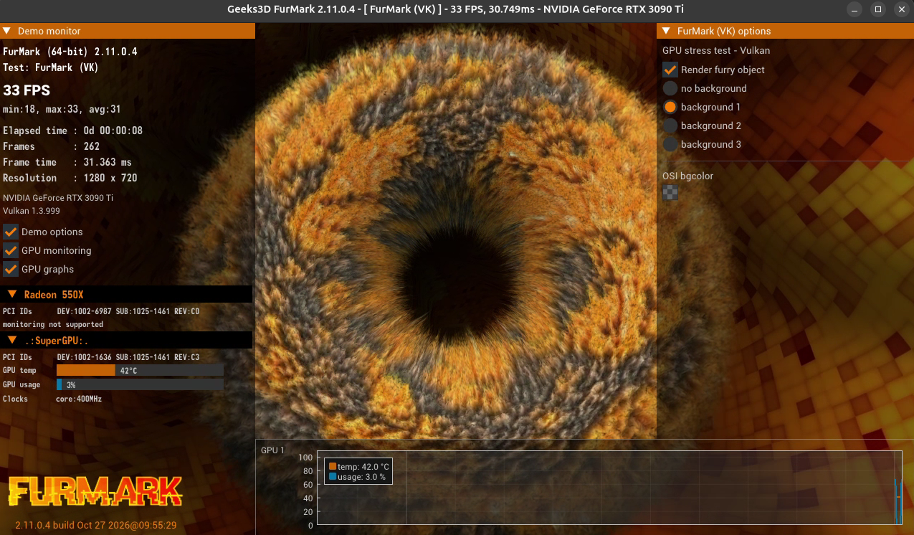
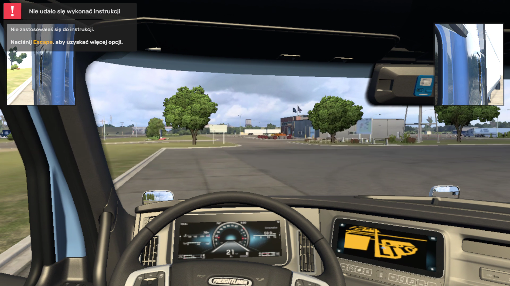
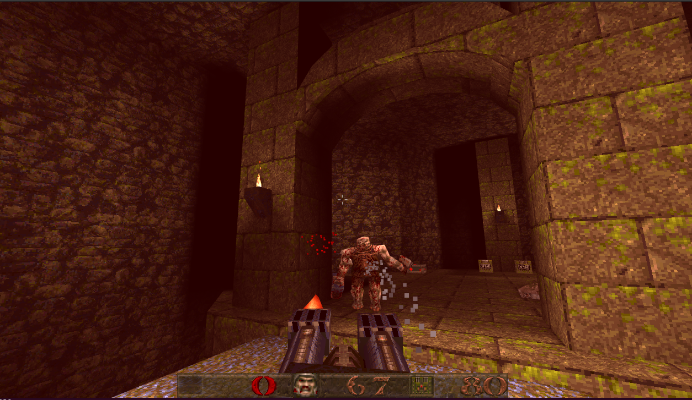
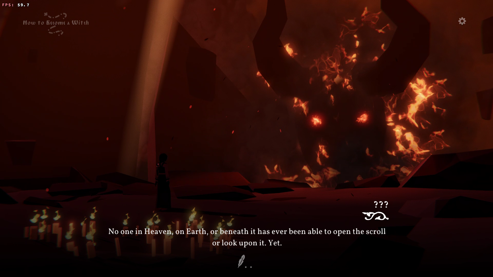
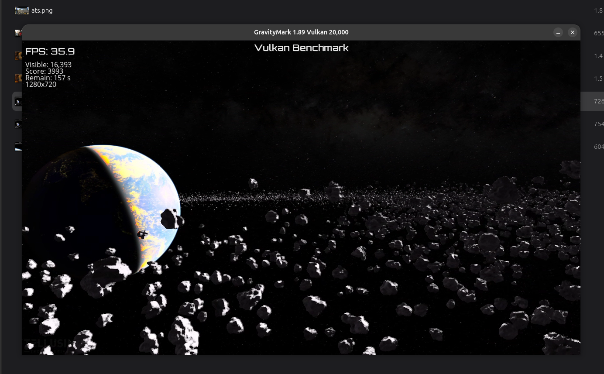

<!-- i18n-switch -->
**English** · [Polski](README.pl.md) · [Español](README.es.md)
<!-- /i18n-switch -->

# gpu-over-wifi

Share one powerful home GPU between your devices: run big AI models, play games on a weak laptop as if it had the strong graphics card, and let the server decide who gets the GPU.

> **Status: early research project.** Things work in the lab, not yet in everyday use. Linux only for now (Windows client is planned). Results per game: [Measurements](#measurements) (at the end).

## Cyberpunk 2077 on a remote GPU: from 2 FPS to **32 FPS** (and still climbing)

**Cyberpunk 2077**, a DirectX 12 game running through Proton and vkd3d-proton on a desktop with a weak CPU (Ryzen 5 1600X), drawn by an RTX 3090 Ti in another machine over a 2.5 Gb/s cable, built-in benchmark, **1920x1080 fullscreen, same settings every run** (the screenshot is a frame from such a run; for reference the same PC with its own, weaker, GTX 1080 Ti (11 GB) gets ~86 FPS at the Low preset with FSR, minimum 65 (our remote runs use a Custom preset with medium shadows and LOD, so the comparison is approximate), so the remote RTX 3090 Ti setup is still far from what the machine does locally. At those settings the game is probably limited by the weak CPU, so a faster card would not raise the local number much):

| Date | Average FPS | Peak | What changed |
|---|---|---|---|
| first attempt | 2-5 | | it started at all |
| 2026-11-05 | 7.6 | 38 | many round trips per frame, lock contention |
| 2026-11-21 morning | 15.5 | | |
| 2026-11-21 evening | 25.5 (25.0-25.8 over repeated runs) | 57 | read-back of GPU results now travels differentially in the same round trip as the wait, read channel, lock-free fetches, self-tuning |
| 2026-11-21 night | 28.1 (27.7-28.1) | 56 | server profiled with `perf`: two hot spots removed on the critical thread |
| 2026-11-21 late night | 29.4 | 55 | memory-write codec picked from the link speed (LZ4 on >= 2 Gb/s), min FPS up from 14 to 17 |
| **2026-11-21 very late night** | **32.0** | **52** | server replies leave immediately instead of waiting for the queue to drain; min FPS 19 |

The game really runs on the client; only the graphics card is remote. No frame generation, no resolution tricks, no per-game profile: the same driver code serves every game. Every number is a measured run from the repository ([`docs/measurements`](docs/measurements/2026-11-19-desktop/README.md), runs in [`cp-bench-runs.tsv`](docs/measurements/cp-bench-runs.tsv), reproduce with `tools/cp-bench.sh`), including the ideas that did **not** help (recorded with their numbers). Still not smooth (the minimum is ~14 FPS and the frame is a chain of ~28 dependent round trips), and work continues.

*FurMark (Vulkan) running on a Ryzen laptop, drawn by the RTX 3090 Ti in another machine over a 1 Gb/s cable, returned as H.264: 1280x720, 98 FPS on average over 10 s (min 68, max 110; the window shows the remote card). It is a GPU stress test, yet the remote GPU is mostly idle here, so the limit is our transport, not the card; that is what we are optimising.*

*American Truck Simulator (native Linux Vulkan game) in the cab on the Ryzen 5 4500U laptop, drawn by the RTX 3090 Ti in another machine over a 1 Gb/s cable: **68-72 FPS** in light scenes (it was 3-45 FPS a day earlier). In a busy cockpit scene with mirrors it drops to about 6 FPS because the game rewrites ~17 MB of mapped memory per frame. The frame-rate overlay was not enabled in this screenshot; the numbers come from the driver's own statistics ([`docs/measurements/2026-11-04-ats`](docs/measurements/2026-11-04-ats/README.md)).*

*Can it run Doom? Not Doom, but **Quake**: vkQuake (native Vulkan, shareware episode) on the Ryzen laptop with the remote driver, a 6 237-frame timedemo at **54 FPS** (34-77) with the RTX 3090 Ti in another machine ([`docs/measurements/2026-11-06-vkquake`](docs/measurements/2026-11-06-vkquake/README.md)).*

*Black Book (Proton, DXVK) on the Ryzen laptop, drawn by the RTX 3090 Ti in another machine: **40-60 FPS** with the game's own counter ([`docs/measurements/2026-11-05-blackbook`](docs/measurements/2026-11-05-blackbook/README.md)).*

*GravityMark 1.89 (Vulkan, 20 000 asteroids, 1280x720) on the Ryzen laptop, drawn by the RTX 3090 Ti in another machine: **30-36 FPS** with the benchmark's own overlay (FPS, score 3 993). It did not start at all that morning; five missing or broken Vulkan entry points were fixed, and the frame rate went 8 -> 17 -> 31 -> 36 FPS over one hour as lazy read-back and descriptor allocation shortcuts were extended to its memory and pools ([`docs/measurements/2026-11-05-gravitymark`](docs/measurements/2026-11-05-gravitymark/README.md)).*

## What is in here

- **GPU hub** (`hub-server`, `hub-client`, `hub-proto`) – a small server that watches the GPU, proxies AI requests (OpenAI-compatible API in front of Ollama) and decides who gets the GPU and when, so a big model and a game do not fight over VRAM. It can also run large models such as DeepSeek through InferSSD (Apache-2.0) on a single consumer card by streaming weights from an NVMe drive.
- **Remote Vulkan** (`gpu-icd`, `gpu-renderd`, `gpu-vkgen`, `gpu-vkcodec`, `gpu-wire`, `gpu-proto`) – a from-scratch Vulkan driver for the *client* that forwards graphics commands over the network to a daemon on the *server*, which runs them on the real GPU and sends the picture back. To the application, the server's card looks like a locally installed GPU.
- **Video** (`gpu-nvenc`, `gpu-vaapi`, `gpu-h264`) – frames are returned either losslessly (LZ4) or as H.264 (hardware-encoded on NVIDIA, hardware-decoded through VA-API on the laptop).

## Where it stands

| Works | Not yet |
|---|---|
| Remote RTX appears in `vulkaninfo`; `vkcube` renders on it and shows locally; **real games run**: American Truck Simulator 68-72 FPS (light scenes), **Cyberpunk 2077 at 1080p: ~32 FPS average** (from 2-5), Hamster Hunter 21-34 FPS, FurMark ~93 FPS | Smooth heavy games: Cyberpunk 2077 (DirectX 12 via Proton) averages ~32 FPS but dips to ~19, and busy scenes (ATS cockpit) drop to ~6 FPS; both are bound by network round trips, plan in [`docs/consult/11-next-steps.md`](docs/consult/11-next-steps.md) |
| LZ4 and H.264 frame transport, selectable (`GPU_ICD_CODEC`) | Windows client driver, HEVC |
| AI proxy with VRAM-aware scheduling, DeepSeek via InferSSD | Game-session reservations in the scheduler |

## Independent development

Commercial products in this space are closed, so there was nothing to copy from: no source code, binaries, protocol specifications or internal documentation of any
such product were available to us or used here. We started from the public, general description of the problem (a remote GPU is a latency and bandwidth problem) and from openly
available material only: the Khronos Vulkan registry and specification, the Vulkan loader and ICD interface documentation, open-source drivers and the Linux kernel documentation, and the
documentation of the compression libraries we use. Every technique in this repository was designed, implemented and measured by us. Where public claims about what is possible could not be
checked, we measured ourselves, and several ideas that sounded promising did not work (they are recorded with their numbers in [`docs/measurements`](docs/measurements/2026-11-05-rottr/README.md) and `AGENTS.md`).

## Test hardware

| Role | Machine | CPU | RAM | GPU | Storage | OS |
|---|---|---|---|---|---|---|
| Client (laptop) | Lenovo ThinkPad 20JNS5UQ0N | Intel Core i5-6300U, 4 threads | 8 GB | Intel HD Graphics 520 (Skylake GT2) | – | Arch Linux (Omarchy), Hyprland/Wayland |
| Client 2 (laptop, used for the game measurements) | Acer laptop (hostname `wasyl-V1-12`) | AMD Ryzen 5 4500U, 6 cores / 6 threads | 6.6 GB usable (upgrade to 16 GB planned) | AMD Radeon Vega (Renoir) integrated + Radeon 550X (Polaris 12) discrete, both disabled for the games | – | Ubuntu 26.04.1, kernel 7.0.0-42, GNOME/Wayland |
| Server A ("gpu-hub") | desktop | AMD Ryzen 9 5900XT, 16 cores | 64 GB DDR4 (AM4 platform) | NVIDIA RTX 3090 Ti, 24 GB, driver 580.178 | Kingston NVMe 2 TB (PCIe 4) | Ubuntu 26.04 |
| Server B | desktop | AMD Ryzen 9 5950X, 16 cores | 64 GB DDR4 (AM4 platform) | NVIDIA RTX 3090, 24 GB, driver 580.105 | ADATA SX8200 NVMe 2 TB + 1 TB SSD | Ubuntu 24.04 |

Link client-A: direct 1 Gb/s Ethernet cable, ~0.2 ms round trip. Client 2 (the Ryzen laptop, all game numbers below): direct 1 Gb/s cable to server A through its built-in Realtek RTL8111/8168 NIC (0.15 ms round trip, `rx-usecs 0`) or a USB 3 Gigabit adapter (RTL8153, ~0.37 ms, less stable); Wi-Fi is Realtek RTL8723BE and not used for rendering. Client-B: VPN (not used for the numbers below).
RAM *type* follows from the platform (Ryzen 5000 on AM4 supports DDR4 only); module speed and timings were not read because that needs root (`dmidecode`) and are marked as TBD.

## Try it

See [`docs/TESTING-OTHER-MACHINE.md`](docs/TESTING-OTHER-MACHINE.md) for building the server daemon and the client driver and running `vkcube` through them. Design notes: [`docs/DESIGN-remote-gpu.md`](docs/DESIGN-remote-gpu.md), [`docs/DESIGN-game-streaming.md`](docs/DESIGN-game-streaming.md). The working status log is [`AGENTS.md`](AGENTS.md).

## Help us test

We want reports from **other laptops, desktops, GPUs and networks**: everything so far was measured on one client and one server. If you have a Linux machine
with a strong NVIDIA GPU and another Linux machine on a 1 Gb/s cable, you can try a game in about 30 minutes and send back numbers (or just "it crashed
at once", which is useful too). What you need, how to run it, what the report contains and where to send it: [`docs/CALL-FOR-TESTERS.md`](docs/CALL-FOR-TESTERS.md);
the report is collected by [`tools/collect-report.sh`](tools/collect-report.sh) (hardware, link, driver statistics; no tokens) and goes into a new issue using the *Test report* template.

## Support the project

If this is useful to you and you want to help it along (a faster test machine, more hardware to test on), you can donate through PayPal to **wasyl@o2.pl**:
[**Donate with PayPal**](https://www.paypal.com/donate?business=wasyl%40o2.pl&no_recurring=0&item_name=gpu-over-wifi&currency_code=PLN).
Donations do not change the license terms (see below) and are not required to use or test the project.

## Security

The remote GPU daemon is **not hardened for untrusted networks**. A client with the token can run arbitrary Vulkan commands on the server's GPU, and a malformed command stream can crash the vendor driver. Use it only on a trusted link (e.g. a direct cable or a VPN), bind it to that interface only, and keep the token file private (`chmod 600`).

## Third-party material

`third_party/vk.xml` and the Vulkan headers come from Khronos (Apache-2.0); `third_party/nvenc/nvEncodeAPI.h` comes from `nv-codec-headers` (MIT-style notice kept in the file, see its README). VA-API types are generated from the system `libva` headers (MIT).

## License

From version 0.3.0: [Functional Source License 1.1 (FSL-1.1-ALv2)](LICENSE). You may use, copy, modify and redistribute the code for any purpose except a **Competing Use** (offering it to others as a commercial product or service that substitutes for it); each version automatically becomes Apache-2.0 two years after its release. Commercial licensing for competing use: contact the author via GitHub. Versions up to 0.2.2 were released under Apache-2.0, see [`docs/LICENSE-HISTORY.md`](docs/LICENSE-HISTORY.md).

## Measurements

All numbers are from single lab runs, not statistics: treat them as orders of magnitude. Results are grouped **by application**; inside each group the **newest result comes first** and the oldest last. The machine each result was measured on is a column, not a heading. Test machines are listed under [Test hardware](#test-hardware). Reproduce with `GPU_ICD_STATS=1` (client) and the tools in `tools/` (`tools/cp-bench.sh`, `tools/ab-run.sh`).

### Cyberpunk 2077 (DirectX 12 -> vkd3d-proton -> `VK_EXT_descriptor_buffer`)

| Date | Client | Result | What changed / what limits it |
|---|---|---|---|
| 2026-11-21 (very late night) | same desktop | **32.0 FPS average**, max 52 (min ~19.3) | the server held its replies until the whole queue of ready requests was drained, so a short query waited behind blocking waits; every reply now leaves immediately (found by timing each phase of a call, not by guessing) |
| 2026-11-21 (late night) | same desktop | **29.4 FPS average**, max 55 (min ~17.2) | on links of 2 Gb/s and faster the memory-write codec is now LZ4 (unpacked by the server's reader thread instead of its executing thread); slower links keep zstd, chosen from the interface speed |
| 2026-11-21 (night) | same desktop, after two server-side profile fixes | **27.7-28.1 FPS average**, max 56 (min ~15.7) | profiling the server with `perf` found two silly hot spots on the critical thread: a full scan of the handle registry on every memory read (9 % of CPU) and a CPU-count syscall storm (5.6 %); 26.5 after the first fix, 28 after the second |
| 2026-11-21 (evening) | Ryzen 5 1600X desktop, 2.5 Gb/s, built-in benchmark, 1920x1080 fullscreen | **25.0-25.8 FPS average, max 57** (min ~14); on the same PC with its own weaker GTX 1080 Ti ~86 FPS (Low preset, FSR) | the frame is a chain of ~28 dependent sync points, each paid a round trip for CPU read-back of GPU results. Hot read-back windows (17 fixed 64 KB windows, ~55 fetches per frame) are read differentially in the same round trip as the wait (server returns only changed pages), plus a dedicated read channel, lock-free lazy fetch, self-tuning, server fixes (leaked driver contexts made `vkCreateDevice` take 8-126 s after ~28 sessions). Tried and **rejected after measurement**: scan outside the global lock, descriptor prefetch, thread priorities, compression variants. Details: [`docs/measurements/2026-11-19-desktop`](docs/measurements/2026-11-19-desktop/README.md) |
| 2026-11-21 (morning) | same desktop | 14.7-16.2 FPS average | before the differential read-back |
| 2026-11-05 | Ryzen 5 4500U laptop, 1 Gb/s, 1080p, 14-minute session | **7.6 FPS median** (p10 7.2, p90 10.6, up to 38 in quiet scenes), frame latency ~18 ms; tester's verdict: playable | 76 round trips per frame (43 are semaphore waits), instance-lock contention, 5 MB of memory writes per frame; [`docs/measurements/2026-11-05-cyberpunk`](docs/measurements/2026-11-05-cyberpunk/README.md) |
| 2026-11-04 | same laptop | 4-5 FPS (2-4 before that) | first runs |

### Rise of the Tomb Raider (Epic, Proton, DX11/DXVK, built-in benchmark, Full HD, high)

| Date | Client | Result | What changed / what limits it |
|---|---|---|---|
| 2026-11-21 (late evening) | Ryzen 5 1600X desktop, 2.5 Gb/s, vsync off | **Overall 40.2 FPS** (Mountain Peak 56.7, Syria 33.0, Geothermal Valley 30.9; 28.3 in the morning) | this game uploads 440-500 MB/s of memory writes, so it needs the compressing zstd-with-prefix codec (LZ4 left the link 70-80 % busy: 36.5 FPS); the codec is now chosen adaptively per session (starts with zstd, switches one way to LZ4 only when traffic stays low); the in-flight frame brake no longer switches itself off for good at startup (menu latency 700 ms -> 50 ms); screenshots in [`docs/measurements/2026-11-19-desktop`](docs/measurements/2026-11-19-desktop/README.md) |
| 2026-11-21 (evening) | Ryzen 5 1600X desktop, 2.5 Gb/s | **Overall 36.5 FPS** (28.3 in the morning; scene 1 56.3, Prophet's Tomb 28.3, Geothermal Valley 25.0; one manual run, no repeats) | the read-back channel was bound to one Vulkan session, so memory of the game's other instances waited 30 s for a frame that never came; per-session channel plus a 16-bit frame-number wrap fix; details in [`docs/measurements/2026-11-19-desktop`](docs/measurements/2026-11-19-desktop/README.md) |
| 2026-11-21 | Ryzen 5 1600X desktop, 2.5 Gb/s | **Overall 28.3-28.5 FPS** (Mountain Peak 29.9, Syria 28.6, Geothermal Valley 26.6); the same with the new options off: 28.5 | DX11/DXVK has no fixed read-back windows, so the differential read-back does not apply; [`docs/measurements/2026-11-21-rottr-desktop`](docs/measurements/2026-11-21-rottr-desktop/README.md) |
| 2026-11-05 | Ryzen 5 4500U laptop, 1 Gb/s | **Overall 25-26 FPS** (Mountain Peak ~38-40, Syria ~18, Geothermal Valley ~19); 9.6 FPS at the start of that round, 1-2 FPS at the first attempt | several Vulkan instances per process routed correctly, whole device-local memories read through a GPU copy; zstd with the previously sent content as a dictionary (wire bytes -53 %), hardware CRC32C, descriptor-buffer memories not refreshed, long `vkWaitSemaphores` returned early with the server executing them in stream order (audited, 0 misses); identical builds differ by about +-4 %; [`docs/measurements/2026-11-05-rottr`](docs/measurements/2026-11-05-rottr/README.md) |

### American Truck Simulator (native Linux, `-rdevice vk`)

| Date | Client | Result | What changed / what limits it |
|---|---|---|---|
| 2026-11-04 | Ryzen 5 4500U laptop, 1 Gb/s, H.264 | **68-72 FPS** in light scenes (was 3-45); busy cockpit scenes with mirrors ~6 FPS | 1.8 M descriptor-set allocations per run were synchronous round trips (125 us each, ~18 ms of a 22 ms frame): now answered locally from pool bookkeeping with a safety margin and a periodic synchronous audit; a server handle-registry limit (2^20) that killed the game after ~1 M sets is fixed; [`docs/measurements/2026-11-04-ats`](docs/measurements/2026-11-04-ats/README.md) |

### Black Book (Heroic, Proton, DXVK)

| Date | Client | Result | What changed / what limits it |
|---|---|---|---|
| 2026-11-05 | Ryzen 5 4500U laptop, 1 Gb/s | **mean 52.7 FPS, 60-63 for most of a 12 000-frame session** (5-10 FPS before) | non-cached mapped memory is read through a GPU copy into RAM instead of slow BAR reads; [`docs/measurements/2026-11-05-blackbook`](docs/measurements/2026-11-05-blackbook/README.md) |

### GravityMark 1.89 (Vulkan, 1280x720, 20 000 asteroids)

| Date | Client | Result | What changed / what limits it |
|---|---|---|---|
| 2026-11-05 | Ryzen 5 4500U laptop, 1 Gb/s | **30-36 FPS** (did not start before; 7-8 FPS at first start) | a fixed ~31 ms per frame on the client side, independent of scene weight and frames in flight; [`docs/measurements/2026-11-05-gravitymark`](docs/measurements/2026-11-05-gravitymark/README.md) |

### FurMark 2.11 (Vulkan, 1280x720)

| Date | Client | Result | What changed / what limits it |
|---|---|---|---|
| 2026-11-03 | Ryzen 5 4500U laptop, 1 Gb/s, H.264 | **~98 FPS**, frame latency ~29 ms (11 -> 21 -> 32 -> ~99 FPS during that day) | the first run was 11 FPS: the server compared the whole mapped memory after every GPU wait (fixed: ranges + streaming loads) |

### Hamster Hunter (Unity, IL2CPP, `-force-vulkan`)

| Date | Client | Result | What changed / what limits it |
|---|---|---|---|
| 2026-11-03 | Ryzen 5 4500U laptop, 1 Gb/s, H.264 | **21-34 FPS** (7 before), frame latency ~20 ms | memory read-back from slow (write-combined) memory: 6.9 -> 1.2 ms per request after the fix |

### vkQuake (native Vulkan, shareware episode)

| Date | Client | Result | What changed / what limits it |
|---|---|---|---|
| 2026-11-06 | Ryzen 5 4500U laptop, 1 Gb/s | 6 237-frame timedemo at **54 FPS** (34-77) | [`docs/measurements/2026-11-06-vkquake`](docs/measurements/2026-11-06-vkquake/README.md) |

### Khronos Vulkan-Samples (headless, 300 frames each)

| Date | Client | Result | What changed / what limits it |
|---|---|---|---|
| 2026-11-06 | Ryzen 5 4500U laptop | **14 samples pass**, including **ray tracing** (`ray_tracing_basic`, `ray_tracing_extended`, `ray_tracing_position_fetch`, `ray_queries`, opt-in `GPU_ICD_RAYTRACING=1`), descriptor buffer, mesh shading, push descriptors | frames dumped and checked; [`docs/measurements/2026-11-06-vulkan-samples`](docs/measurements/2026-11-06-vulkan-samples/README.md) |

### vkcube (synthetic, 650x718, release build, client laptop -> server A)

How each design step changed the same scene:

| Step | Frames/s | Notes |
|---|---|---|
| 1. Synchronous read-back of every frame over the network | ~27 | 1.87 MB/frame, 7 round trips/frame, read-back 28.8 ms |
| 2. Asynchronous frames on a second connection, raw | 44 | app no longer waits for the picture |
| 3. + LZ4 | 46 | 62 KB/frame (30x smaller on this flat scene) |
| 4. + non-vsync present (`mailbox`) | ~314 | local present 20.2 -> 1.2 ms per frame (FIFO was waiting for vsync) |

Frame codec comparison (per frame, `mailbox`):

| Codec | Size | Receive | Decode | Present |
|---|---|---|---|---|
| LZ4 (lossless, default) | 62 KB | 0.1 ms | 1.0 ms | 1.2 ms |
| H.264 (NVENC -> VA-API) | 32 KB | 0.2 ms | 8.8 ms | 1.1 ms |

On a cable the lossless LZ4 path is faster; H.264 is meant for slower links. `vkcube` is a flat, simple scene, so it flatters LZ4 and says little about real games.

### Building blocks

| Measurement | Result |
|---|---|
| Submit + wait + read back 4 KiB on the remote GPU | 1.16 ms (median) |
| NVENC H.264 encode incl. host->GPU copy, 1920x1080 / 640x360 | 1.62 ms / 0.27 ms (median) |
| VA-API H.264 decode + read-back + NV12->BGRA on the HD 520, 1920x1080 / 640x360 | 36.6 ms / 4.3 ms (median) |
| Host -> GPU copy of one 1080p frame (CUDA) | 0.41 ms (20 GB/s) |
| Sessions seeing the NVIDIA card after the loader-unload fix (40 killed + 20 normal clients) | 60 / 60 (before: 10 / 50) |

### AI hub: DeepSeek V4.1 Flash via InferSSD (server A, one NVMe, context 16384, thinking off)

| Configuration | Generation | Prompt processing |
|---|---|---|
| Plain GGUF files (baseline) | 3.37 tok/s | 5.7 tok/s |
| Expert pack (re-laid-out for the SSD) | 4.76 tok/s (+41%) | 8.1 tok/s |
| Same, through the hub | 4.66 tok/s | 8.0 tok/s |
| Long prompt (4105 tokens) with 2 GB VRAM headroom | 3.02 tok/s | 55.7 tok/s |

About half of the remaining time per token is waiting for the single NVMe drive; details and the dead ends are in [`docs/OPTIMIZATION-inferssd.md`](docs/OPTIMIZATION-inferssd.md).
