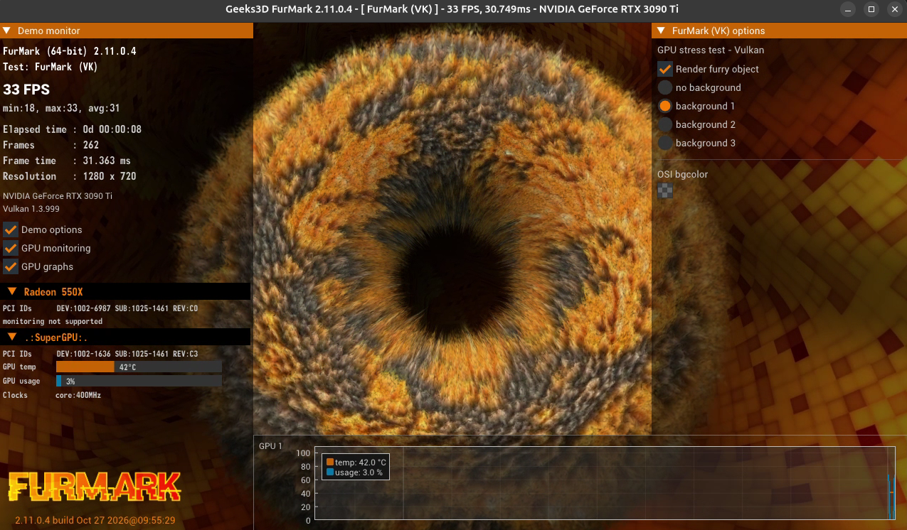
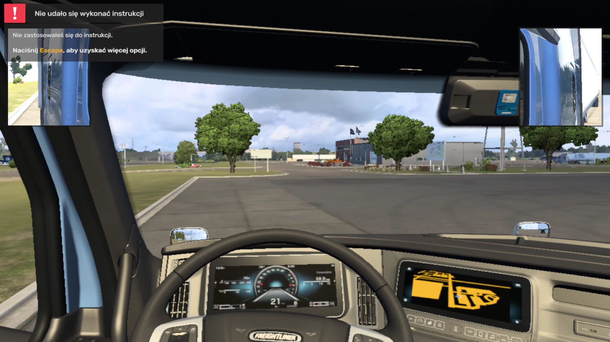
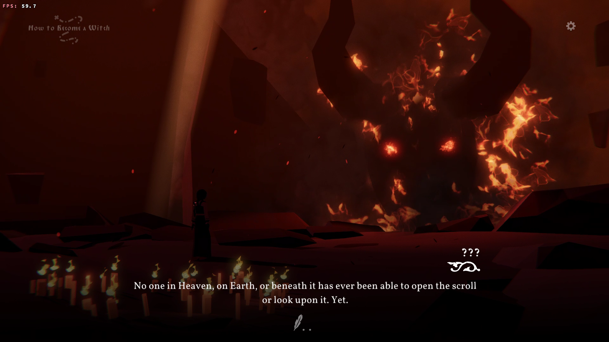
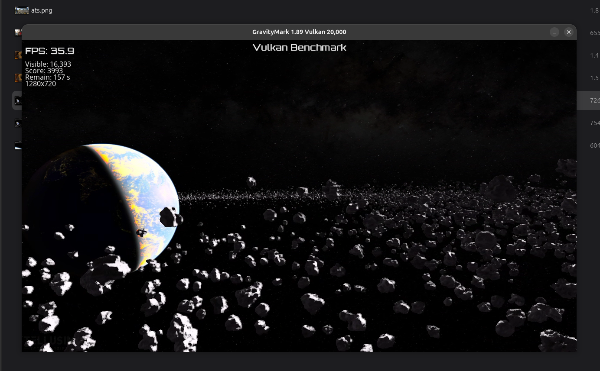

# gpu-over-wifi

Share one powerful home GPU between your devices: run big AI models, play games on a weak laptop as if it had the strong graphics card, and let the server decide who gets the GPU.

> **Status: early research project.** Things work in the lab, not yet in everyday use. Linux only for now (Windows client is planned).

*FurMark (Vulkan) running on a Ryzen laptop, drawn by the RTX 3090 Ti in another machine over a 1 Gb/s cable, returned as H.264: 1280x720, 98 FPS on average over 10 s (min 68, max 110; the window shows the remote card). It is a GPU stress test, yet the remote GPU is mostly idle here, so the limit is our transport, not the card; that is what we are optimising.*

*American Truck Simulator (native Linux Vulkan game) in the cab on the Ryzen 5 4500U laptop, drawn by the RTX 3090 Ti in another machine over a 1 Gb/s cable: **68-72 FPS** in light scenes (it was 3-45 FPS a day earlier). In a busy cockpit scene with mirrors it drops to about 6 FPS because the game rewrites ~17 MB of mapped memory per frame. The frame-rate overlay was not enabled in this screenshot; the numbers come from the driver's own statistics ([`docs/measurements/2026-11-04-ats`](docs/measurements/2026-11-04-ats/README.md)).*

*Black Book (Proton, DXVK) on the Ryzen laptop, drawn by the RTX 3090 Ti in another machine: **40-60 FPS** with the game's own counter ([`docs/measurements/2026-11-05-blackbook`](docs/measurements/2026-11-05-blackbook/README.md)).*

*GravityMark 1.89 (Vulkan, 20 000 asteroids, 1280x720) on the Ryzen laptop, drawn by the RTX 3090 Ti in another machine: **30-36 FPS** with the benchmark's own overlay (FPS, score 3 993). It did not start at all that morning; five missing or broken Vulkan entry points were fixed, and the frame rate went 8 -> 17 -> 31 -> 36 FPS over one hour as lazy read-back and descriptor allocation shortcuts were extended to its memory and pools ([`docs/measurements/2026-11-05-gravitymark`](docs/measurements/2026-11-05-gravitymark/README.md)).*

*Cyberpunk 2077, a DirectX 12 game running through Proton and vkd3d-proton on the Ryzen laptop, drawn by the RTX 3090 Ti in another machine (the screenshot is from the intro cutscene, 1024x768 window). It is now **playable**: in a 14-minute session at 1080p it ran at **7.6 FPS median (up to 38 FPS in quiet moments)**, up from 2-5 FPS a day earlier, and the tester called it playable. It is still far from smooth: every frame waits for ~76 network round trips, mostly semaphore waits, and about 5 MB of mapped memory is uploaded per frame ([`docs/measurements/2026-11-05-cyberpunk`](docs/measurements/2026-11-05-cyberpunk/README.md), next steps in [`docs/consult/11-next-steps.md`](docs/consult/11-next-steps.md)).*

## What is in here

- **GPU hub** (`hub-server`, `hub-client`, `hub-proto`) – a small server that watches the GPU, proxies AI requests (OpenAI-compatible API in front of Ollama) and decides who gets the GPU and when, so a big model and a game do not fight over VRAM. It can also run large models such as DeepSeek through [InferSSD](https://github.com/wici-ai/inferssd) (Apache-2.0) on a single consumer card by streaming weights from an NVMe drive.
- **Remote Vulkan** (`gpu-icd`, `gpu-renderd`, `gpu-vkgen`, `gpu-vkcodec`, `gpu-wire`, `gpu-proto`) – a from-scratch Vulkan driver for the *client* that forwards graphics commands over the network to a daemon on the *server*, which runs them on the real GPU and sends the picture back. To the application, the server's card looks like a locally installed GPU.
- **Video** (`gpu-nvenc`, `gpu-vaapi`, `gpu-h264`) – frames are returned either losslessly (LZ4) or as H.264 (hardware-encoded on NVIDIA, hardware-decoded through VA-API on the laptop).

## Where it stands

| Works | Not yet |
|---|---|
| Remote RTX appears in `vulkaninfo`; `vkcube` renders on it and shows locally; **real games run**: American Truck Simulator 68-72 FPS (light scenes), Cyberpunk 2077 playable at ~8 FPS (38 in quiet scenes), Hamster Hunter 21-34 FPS, FurMark ~93 FPS | Smooth heavy games: Cyberpunk 2077 (DirectX 12 via Proton) is playable but far from 30 FPS and busy scenes (ATS cockpit) drop to ~6 FPS; both are bound by network round trips and per-frame memory uploads, plan in [`docs/consult/11-next-steps.md`](docs/consult/11-next-steps.md) |
| LZ4 and H.264 frame transport, selectable (`GPU_ICD_CODEC`) | Windows client driver, HEVC |
| AI proxy with VRAM-aware scheduling, DeepSeek via InferSSD | Game-session reservations in the scheduler |

## Test hardware

| Role | Machine | CPU | RAM | GPU | Storage | OS |
|---|---|---|---|---|---|---|
| Client (laptop) | Lenovo ThinkPad 20JNS5UQ0N | Intel Core i5-6300U, 4 threads | 8 GB | Intel HD Graphics 520 (Skylake GT2) | – | Arch Linux (Omarchy), Hyprland/Wayland |
| Client 2 (laptop, used for the game measurements) | Acer laptop (hostname `wasyl-V1-12`) | AMD Ryzen 5 4500U, 6 cores / 6 threads | 6.6 GB usable (upgrade to 16 GB planned) | AMD Radeon Vega (Renoir) integrated + Radeon 550X (Polaris 12) discrete, both disabled for the games | – | Ubuntu 26.04.1, kernel 7.0.0-42, GNOME/Wayland |
| Server A ("gpu-hub") | desktop | AMD Ryzen 9 5900XT, 16 cores | 64 GB DDR4 (AM4 platform) | NVIDIA RTX 3090 Ti, 24 GB, driver 580.178 | Kingston NVMe 2 TB (PCIe 4) | Ubuntu 26.04 |
| Server B | desktop | AMD Ryzen 9 5950X, 16 cores | 64 GB DDR4 (AM4 platform) | NVIDIA RTX 3090, 24 GB, driver 580.105 | ADATA SX8200 NVMe 2 TB + 1 TB SSD | Ubuntu 24.04 |

Link client-A: direct 1 Gb/s Ethernet cable, ~0.2 ms round trip. Client 2 (the Ryzen laptop, all game numbers below): direct 1 Gb/s cable to server A through its built-in Realtek RTL8111/8168 NIC (0.15 ms round trip, `rx-usecs 0`) or a USB 3 Gigabit adapter (RTL8153, ~0.37 ms, less stable); Wi-Fi is Realtek RTL8723BE and not used for rendering. Client-B: VPN (not used for the numbers below).
RAM *type* follows from the platform (Ryzen 5000 on AM4 supports DDR4 only); module speed and timings were not read because that needs root (`dmidecode`) and are marked as TBD.

## Measurements

All numbers are from single lab runs, not statistics: treat them as orders of magnitude. Reproduce with `GPU_ICD_STATS=1` (client) and the tools in `tools/`.

### Remote Vulkan (client laptop -> server A, `vkcube`, 650x718, release build)

How each design step changed the same scene:

| Step | Frames/s | Notes |
|---|---|---|
| 1. Synchronous read-back of every frame over the network | ~27 | 1.87 MB/frame, 7 round trips/frame, read-back 28.8 ms |
| 2. Asynchronous frames on a second connection, raw | 44 | app no longer waits for the picture |
| 3. + LZ4 | 46 | 62 KB/frame (30x smaller on this flat scene) |
| 4. + non-vsync present (`mailbox`) | ~314 | local present 20.2 -> 1.2 ms per frame (FIFO was waiting for vsync) |

Frame codec comparison (per frame, `mailbox`):

| Codec | Size | Receive | Decode | Present |
|---|---|---|---|---|
| LZ4 (lossless, default) | 62 KB | 0.1 ms | 1.0 ms | 1.2 ms |
| H.264 (NVENC -> VA-API) | 32 KB | 0.2 ms | 8.8 ms | 1.1 ms |

On a cable the lossless LZ4 path is faster; H.264 is meant for slower links. `vkcube` is a flat, simple scene, so it flatters LZ4 and says little about real games.

Building blocks:

| Measurement | Result |
|---|---|
| Submit + wait + read back 4 KiB on the remote GPU | 1.16 ms (median) |
| NVENC H.264 encode incl. host->GPU copy, 1920x1080 / 640x360 | 1.62 ms / 0.27 ms (median) |
| VA-API H.264 decode + read-back + NV12->BGRA on the HD 520, 1920x1080 / 640x360 | 36.6 ms / 4.3 ms (median) |
| Host -> GPU copy of one 1080p frame (CUDA) | 0.41 ms (20 GB/s) |
| Sessions seeing the NVIDIA card after the loader-unload fix (40 killed + 20 normal clients) | 60 / 60 (before: 10 / 50) |

### Real applications (Ryzen 5 4500U laptop -> server A, 1 Gb/s cable, H.264, lab runs)

| Application | API path | Result | What limits it |
|---|---|---|---|
| FurMark 2.11 (Vulkan, 1280x720) | native Vulkan | ~98 FPS, frame latency ~29 ms | first run was 11 FPS: server compared the whole mapped memory after every GPU wait (fixed: ranges + streaming loads) |
| Hamster Hunter (Unity, IL2CPP) | native Vulkan, `-force-vulkan` | 21-34 FPS, frame latency ~20 ms | memory read-back from slow (write-combined) memory: 6.9 -> 1.2 ms per request after the fix |
| American Truck Simulator (native Linux, `-rdevice vk`) | native Vulkan | **68-72 FPS** (was 3-45) | 1.8 M descriptor-set allocations per run were synchronous round trips (125 us each, ~18 ms of a 22 ms frame): now answered locally from pool bookkeeping with a safety margin and a periodic synchronous audit; a server handle-registry limit (2^20) that killed the game after ~1 M sets is fixed |
| Black Book (Heroic, Proton, DXVK) | DX11 via DXVK | **mean 52.7 FPS, 60-63 for most of a 12 000-frame session** (5-10 FPS before the GPU-copy read-back) | non-cached mapped memory is now read through a GPU copy into RAM instead of slow BAR reads; [`docs/measurements/2026-11-05-blackbook`](docs/measurements/2026-11-05-blackbook/README.md) |
| Rise of the Tomb Raider (Epic, Proton, DX11/DXVK, built-in benchmark, high settings) | DX11 via DXVK | **mean ~20 FPS, 25-66 early, 6-13 in the heaviest scenes** (1-2 FPS at the first attempt); the same at 1280x720 and 1920x1080, so synchronisation and not rendering is the limit | several Vulkan instances per process are now routed correctly, whole device-local memories are read through a GPU copy; [`docs/measurements/2026-11-05-rottr`](docs/measurements/2026-11-05-rottr/README.md) |
| GravityMark 1.89 (Vulkan, 1280x720) | native Vulkan | **30-33 FPS** (did not start before; 7-8 FPS at first start) | a fixed ~31 ms per frame on the client side, independent of scene weight and frames in flight; details in [`docs/measurements/2026-11-05-gravitymark`](docs/measurements/2026-11-05-gravitymark/README.md) |
| Cyberpunk 2077 | DirectX 12 -> vkd3d-proton -> `VK_EXT_descriptor_buffer` | **7.6 FPS median (p10 7.2, p90 10.6, up to 38 in quiet scenes), frame latency ~18 ms; tester's verdict: playable** (was 4-5 FPS a day earlier, 2-4 before that) | 76 round trips per frame (43 are semaphore waits), instance-lock contention, 5 MB of memory writes per frame; details in [`docs/measurements/2026-11-05-cyberpunk`](docs/measurements/2026-11-05-cyberpunk/README.md) |

### AI hub (server A, DeepSeek V4.1 Flash via InferSSD, one NVMe, context 16384, thinking off)

| Configuration | Generation | Prompt processing |
|---|---|---|
| Plain GGUF files (baseline) | 3.37 tok/s | 5.7 tok/s |
| Expert pack (re-laid-out for the SSD) | 4.76 tok/s (+41%) | 8.1 tok/s |
| Same, through the hub | 4.66 tok/s | 8.0 tok/s |
| Long prompt (4105 tokens) with 2 GB VRAM headroom | 3.02 tok/s | 55.7 tok/s |

About half of the remaining time per token is waiting for the single NVMe drive; details and the dead ends are in [`docs/OPTIMIZATION-inferssd.md`](docs/OPTIMIZATION-inferssd.md).

## Try it

See [`docs/TESTING-OTHER-MACHINE.md`](docs/TESTING-OTHER-MACHINE.md) for building the server daemon and the client driver and running `vkcube` through them. Design notes: [`docs/DESIGN-remote-gpu.md`](docs/DESIGN-remote-gpu.md), [`docs/DESIGN-game-streaming.md`](docs/DESIGN-game-streaming.md). The working status log is [`AGENTS.md`](AGENTS.md).

## Help us test

We want reports from **other laptops, desktops, GPUs and networks**: everything so far was measured on one client and one server. If you have a Linux machine
with a strong NVIDIA GPU and another Linux machine on a 1 Gb/s cable, you can try a game in about 30 minutes and send back numbers (or just "it crashed
at once", which is useful too). What you need, how to run it, what the report contains and where to send it: [`docs/CALL-FOR-TESTERS.md`](docs/CALL-FOR-TESTERS.md);
the report is collected by [`tools/collect-report.sh`](tools/collect-report.sh) (hardware, link, driver statistics; no tokens) and goes into a new issue using the *Test report* template.

## Support the project

If this is useful to you and you want to help it along (a faster test machine, more hardware to test on), you can donate through PayPal to **wasyl@o2.pl**:
[**Donate with PayPal**](https://www.paypal.com/donate?business=wasyl%40o2.pl&no_recurring=0&item_name=gpu-over-wifi&currency_code=PLN).
Donations do not change the license terms (see below) and are not required to use or test the project.

## Security

The remote GPU daemon is **not hardened for untrusted networks**. A client with the token can run arbitrary Vulkan commands on the server's GPU, and a malformed command stream can crash the vendor driver. Use it only on a trusted link (e.g. a direct cable or a VPN), bind it to that interface only, and keep the token file private (`chmod 600`).

## Third-party material

`third_party/vk.xml` and the Vulkan headers come from Khronos (Apache-2.0); `third_party/nvenc/nvEncodeAPI.h` comes from `nv-codec-headers` (MIT-style notice kept in the file, see its README). VA-API types are generated from the system `libva` headers (MIT).

## License

From version 0.3.0: [Functional Source License 1.1 (FSL-1.1-ALv2)](LICENSE). You may use, copy, modify and redistribute the code for any purpose except a **Competing Use** (offering it to others as a commercial product or service that substitutes for it); each version automatically becomes Apache-2.0 two years after its release. Commercial licensing for competing use: contact the author via GitHub. Versions up to 0.2.2 were released under Apache-2.0, see [`docs/LICENSE-HISTORY.md`](docs/LICENSE-HISTORY.md).
