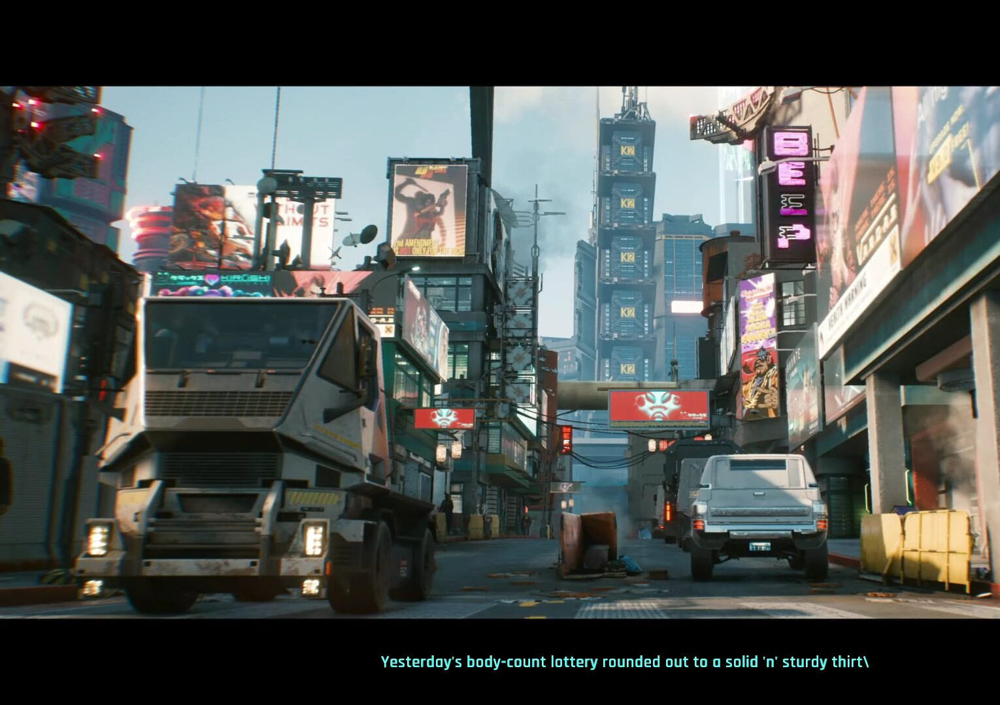
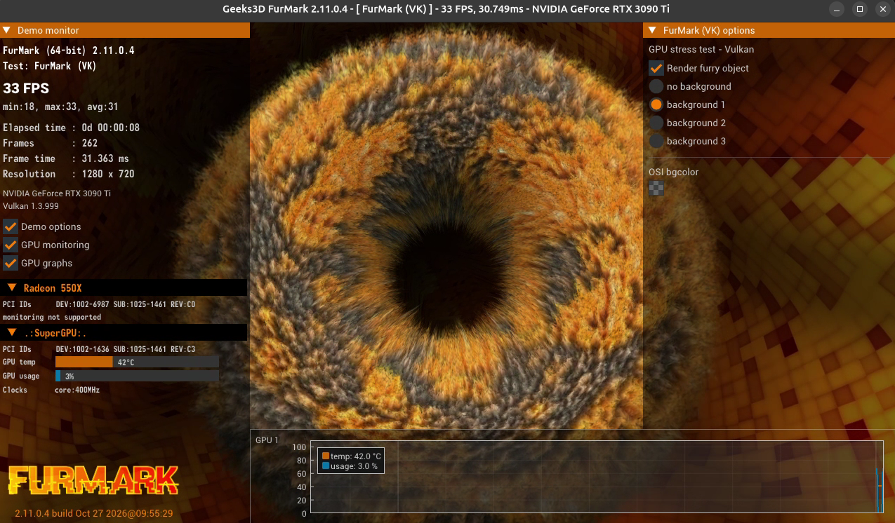
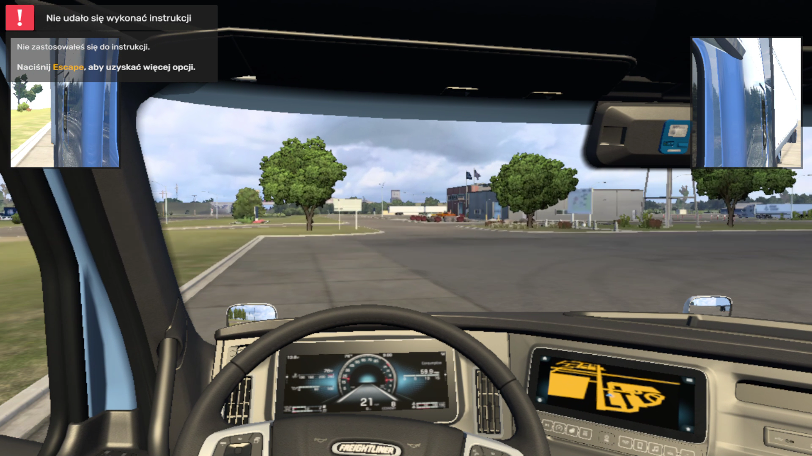
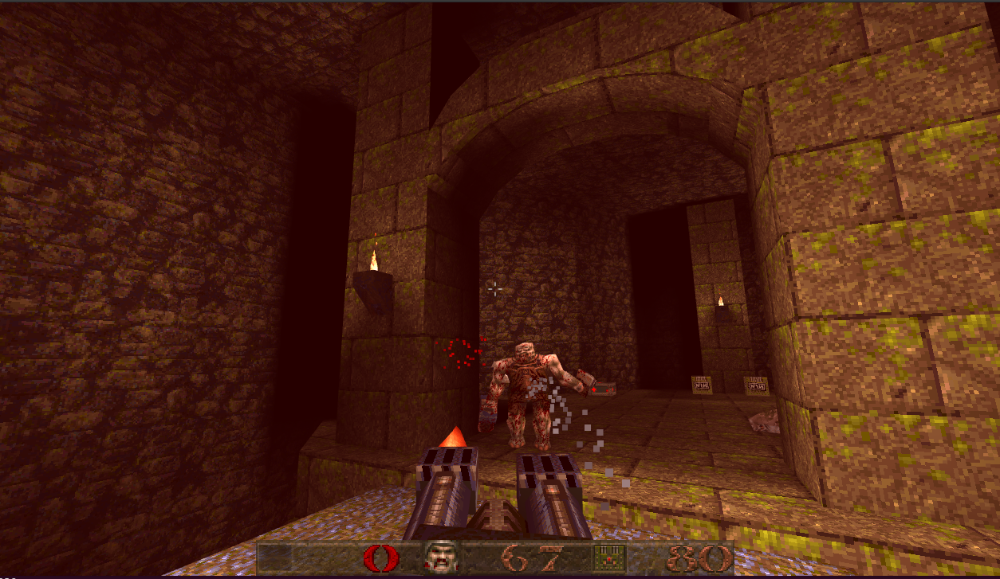
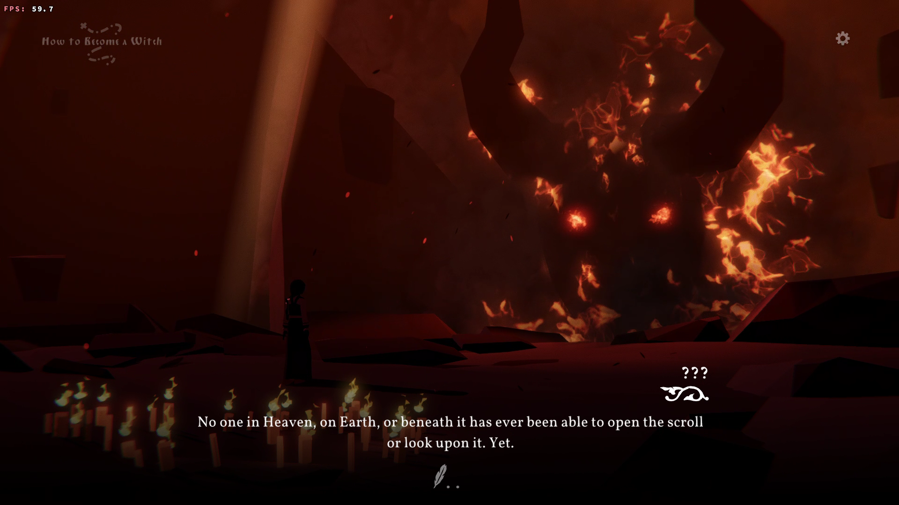
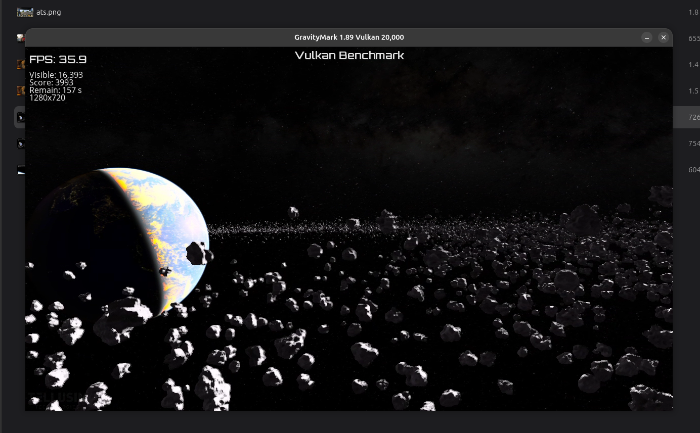

<!-- i18n-switch -->
[English](README.md) · **Polski** · [Español](README.es.md)
<!-- /i18n-switch -->

# gpu-over-wifi

Udostępniaj jedną wydajną domową kartę graficzną między swoimi urządzeniami: uruchamiaj duże modele AI, graj na słabym laptopie tak, jakby miał mocną kartę graficzną, i pozwól serwerowi decydować, kto dostaje GPU.

> **Status: wczesny projekt badawczy.** Rzeczy działają w laboratorium, jeszcze nie w codziennym użytku. Na razie tylko Linux (klient Windows jest planowany). Wyniki dla poszczególnych gier: [Pomiary](#measurements) (na końcu).

## Cyberpunk 2077 na zdalnym GPU: z 2 FPS do **32 FPS** (i wciąż rośnie)

**Cyberpunk 2077**, gra DirectX 12 działająca przez Proton i vkd3d-proton na desktopie ze słabym CPU (Ryzen 5 1600X), rysowana przez RTX 3090 Ti w innej maszynie po kablu 2,5 Gb/s, wbudowany benchmark, **1920x1080 na pełnym ekranie, te same ustawienia przy każdym uruchomieniu** (zrzut ekranu to klatka z takiego uruchomienia; dla porównania ten sam PC z własną, słabszą, GTX 1080 Ti (11 GB) osiąga ~86 FPS na ustawieniu Low z FSR, minimum 65 (nasze zdalne uruchomienia używają ustawienia Custom ze średnimi cieniami i LOD, więc porównanie jest przybliżone), więc zdalna konfiguracja z RTX 3090 Ti wciąż jest daleko od tego, co maszyna robi lokalnie. Przy tych ustawieniach gra jest prawdopodobnie ograniczona przez słaby CPU, więc szybsza karta nie podniosłaby znacząco lokalnego wyniku):

| Data | Średni FPS | Szczyt | Co się zmieniło |
|---|---|---|---|
| pierwsza próba | 2-5 | | w ogóle wystartowała |
| 2026-11-05 | 7,6 | 38 | wiele round tripów na klatkę, kontencja blokad |
| 2026-11-21 rano | 15,5 | | |
| 2026-11-21 wieczorem | 25,5 (25,0-25,8 w powtarzanych uruchomieniach) | 57 | odczyt zwrotny wyników GPU podróżuje teraz różnicowo w tym samym round tripie co oczekiwanie, kanał odczytu, bezblokadowe pobieranie, samostrojenie |
| 2026-11-21 w nocy | 28,1 (27,7-28,1) | 56 | serwer sprofilowany za pomocą `perf`: usunięto dwa gorące punkty na wątku krytycznym |
| 2026-11-21 późno w nocy | 29,4 | 55 | kodek zapisu pamięci wybierany na podstawie prędkości łącza (LZ4 przy >= 2 Gb/s), minimalny FPS wzrósł z 14 do 17 |
| **2026-11-21 bardzo późno w nocy** | **32,0** | **52** | odpowiedzi serwera wychodzą natychmiast zamiast czekać na opróżnienie kolejki; minimalny FPS 19 |

Gra naprawdę działa na kliencie; tylko karta graficzna jest zdalna. Bez generowania klatek, bez sztuczek z rozdzielczością, bez profili per gra: ten sam kod sterownika obsługuje każdą grę. Każda liczba to zmierzone uruchomienie z repozytorium ([`docs/measurements`](docs/measurements/2026-11-19-desktop/README.md), uruchomienia w [`cp-bench-runs.tsv`](docs/measurements/cp-bench-runs.tsv), odtworzenie za pomocą `tools/cp-bench.sh`), włącznie z pomysłami, które **nie** pomogły (zapisane z ich liczbami). Wciąż nie jest płynnie (minimum to ~14 FPS, a klatka to łańcuch ~28 zależnych round tripów) i prace trwają.

*FurMark (Vulkan) działający na laptopie z Ryzen, rysowany przez RTX 3090 Ti w innej maszynie po kablu 1 Gb/s, zwracany jako H.264: 1280x720, średnio 98 FPS przez 10 s (min 68, maks. 110; okno pokazuje zdalną kartę). To test obciążeniowy GPU, a mimo to zdalne GPU jest tu w większości bezczynne, więc limitem jest nasz transport, nie karta; to właśnie optymalizujemy.*

*American Truck Simulator (natywna linuksowa gra Vulkan) w kabinie na laptopie z Ryzen 5 4500U, rysowany przez RTX 3090 Ti w innej maszynie po kablu 1 Gb/s: **68-72 FPS** w lekkich scenach (dzień wcześniej było 3-45 FPS). W zatłoczonej scenie w kokpicie z lusterkami spada do około 6 FPS, ponieważ gra przepisuje ~17 MB zmapowanej pamięci na klatkę. Nakładka z licznikiem klatek nie była włączona na tym zrzucie; liczby pochodzą z własnych statystyk sterownika ([`docs/measurements/2026-11-04-ats`](docs/measurements/2026-11-04-ats/README.md)).*

*Czy to uruchomi Dooma? Nie Dooma, ale **Quake'a**: vkQuake (natywny Vulkan, epizod shareware) na laptopie z Ryzen ze zdalnym sterownikiem, timedemo 6 237 klatek przy **54 FPS** (34-77) z RTX 3090 Ti w innej maszynie ([`docs/measurements/2026-11-06-vkquake`](docs/measurements/2026-11-06-vkquake/README.md)).*

*Black Book (Proton, DXVK) na laptopie z Ryzen, rysowany przez RTX 3090 Ti w innej maszynie: **40-60 FPS** według własnego licznika gry ([`docs/measurements/2026-11-05-blackbook`](docs/measurements/2026-11-05-blackbook/README.md)).*

*GravityMark 1.89 (Vulkan, 20 000 asteroid, 1280x720) na laptopie z Ryzen, rysowany przez RTX 3090 Ti w innej maszynie: **30-36 FPS** według własnej nakładki benchmarku (FPS, wynik 3 993). Rano w ogóle nie startował; naprawiono pięć brakujących lub uszkodzonych punktów wejścia Vulkan, a liczba klatek wzrosła 8 -> 17 -> 31 -> 36 FPS w ciągu godziny, gdy leniwe odczyty zwrotne i skróty alokacji deskryptorów rozszerzono na jego pamięć i pule ([`docs/measurements/2026-11-05-gravitymark`](docs/measurements/2026-11-05-gravitymark/README.md)).*

## Co tu jest

- **Hub GPU** (`hub-server`, `hub-client`, `hub-proto`) – mały serwer, który obserwuje GPU, pośredniczy w żądaniach AI (API zgodne z OpenAI przed Ollamą) i decyduje, kto i kiedy dostaje GPU, aby duży model i gra nie walczyły o VRAM. Może też uruchamiać duże modele, takie jak DeepSeek, przez InferSSD (Apache-2.0) na pojedynczej konsumenckiej karcie, strumieniując wagi z dysku NVMe.
- **Zdalny Vulkan** (`gpu-icd`, `gpu-renderd`, `gpu-vkgen`, `gpu-vkcodec`, `gpu-wire`, `gpu-proto`) – napisany od zera sterownik Vulkan dla *klienta*, który przekazuje polecenia graficzne przez sieć do demona na *serwerze*, który wykonuje je na prawdziwym GPU i odsyła obraz. Dla aplikacji karta serwera wygląda jak lokalnie zainstalowane GPU.
- **Wideo** (`gpu-nvenc`, `gpu-vaapi`, `gpu-h264`) – klatki są zwracane bezstratnie (LZ4) lub jako H.264 (sprzętowo kodowane na NVIDIA, sprzętowo dekodowane przez VA-API na laptopie).

## Na jakim etapie jest projekt

| Działa | Jeszcze nie |
|---|---|
| Zdalny RTX pojawia się w `vulkaninfo`; `vkcube` renderuje na nim i pokazuje lokalnie; **prawdziwe gry działają**: American Truck Simulator 68-72 FPS (lekkie sceny), **Cyberpunk 2077 w 1080p: średnio ~32 FPS** (z 2-5), Hamster Hunter 21-34 FPS, FurMark ~93 FPS | Płynne wymagające gry: Cyberpunk 2077 (DirectX 12 przez Proton) średnio ~32 FPS, ale spada do ~19, a zatłoczone sceny (kokpit ATS) spadają do ~6 FPS; oba przypadki są ograniczone przez round tripy sieciowe, plan w [`docs/consult/11-next-steps.md`](docs/consult/11-next-steps.md) |
| Transport klatek LZ4 i H.264, wybieralny (`GPU_ICD_CODEC`) | Sterownik klienta Windows, HEVC |
| Proxy AI z planowaniem uwzględniającym VRAM, DeepSeek przez InferSSD | Rezerwacje sesji gier w planiście |

## Niezależny rozwój

Komercyjne produkty w tej dziedzinie są zamknięte, więc nie było z czego kopiować: żaden kod źródłowy, pliki binarne, specyfikacje protokołów ani wewnętrzna dokumentacja żadnego
takiego produktu nie były dla nas dostępne ani tu użyte. Zaczęliśmy od publicznego, ogólnego opisu problemu (zdalne GPU to problem opóźnień i przepustowości) i wyłącznie od otwarcie
dostępnych materiałów: rejestru i specyfikacji Khronos Vulkan, dokumentacji loadera Vulkan i interfejsu ICD, sterowników open-source i dokumentacji jądra Linux oraz
dokumentacji bibliotek kompresji, których używamy. Każda technika w tym repozytorium została zaprojektowana, zaimplementowana i zmierzona przez nas. Tam, gdzie publiczne twierdzenia o możliwościach nie mogły być
sprawdzone, mierzyliśmy sami, a kilka pomysłów, które brzmiały obiecująco, nie zadziałało (są zapisane z ich liczbami w [`docs/measurements`](docs/measurements/2026-11-05-rottr/README.md) i `AGENTS.md`).

## Sprzęt testowy

| Rola | Maszyna | CPU | RAM | GPU | Pamięć masowa | System operacyjny |
|---|---|---|---|---|---|---|
| Klient (laptop) | Lenovo ThinkPad 20JNS5UQ0N | Intel Core i5-6300U, 4 wątki | 8 GB | Intel HD Graphics 520 (Skylake GT2) | – | Arch Linux (Omarchy), Hyprland/Wayland |
| Klient 2 (laptop, używany do pomiarów gier) | Laptop Acer (nazwa hosta `wasyl-V1-12`) | AMD Ryzen 5 4500U, 6 rdzeni / 6 wątków | 6,6 GB użyteczne (planowana rozbudowa do 16 GB) | AMD Radeon Vega (Renoir) zintegrowana + Radeon 550X (Polaris 12) dedykowana, obie wyłączone dla gier | – | Ubuntu 26.04.1, jądro 7.0.0-42, GNOME/Wayland |
| Serwer A ("gpu-hub") | desktop | AMD Ryzen 9 5900XT, 16 rdzeni | 64 GB DDR4 (platforma AM4) | NVIDIA RTX 3090 Ti, 24 GB, sterownik 580.178 | Kingston NVMe 2 TB (PCIe 4) | Ubuntu 26.04 |
| Serwer B | desktop | AMD Ryzen 9 5950X, 16 rdzeni | 64 GB DDR4 (platforma AM4) | NVIDIA RTX 3090, 24 GB, sterownik 580.105 | ADATA SX8200 NVMe 2 TB + 1 TB SSD | Ubuntu 24.04 |

Łącze klient-A: bezpośredni kabel Ethernet 1 Gb/s, ~0,2 ms round trip. Klient 2 (laptop z Ryzen, wszystkie poniższe liczby z gier): bezpośredni kabel 1 Gb/s do serwera A przez wbudowany kontroler Realtek RTL8111/8168 (0,15 ms round trip, `rx-usecs 0`) lub adapter USB 3 Gigabit (RTL8153, ~0,37 ms, mniej stabilny); Wi-Fi to Realtek RTL8723BE i nie jest używane do renderowania. Klient-B: VPN (nieużywany dla poniższych liczb).
*Typ* pamięci RAM wynika z platformy (Ryzen 5000 na AM4 obsługuje tylko DDR4); prędkość modułów i timingi nie zostały odczytane, ponieważ wymaga to uprawnień root (`dmidecode`) i są oznaczone jako TBD.

## Wypróbuj

Zobacz [`docs/TESTING-OTHER-MACHINE.md`](docs/TESTING-OTHER-MACHINE.md), aby zbudować demona serwera i sterownik klienta oraz uruchomić `vkcube` przez nie. Notatki projektowe: [`docs/DESIGN-remote-gpu.md`](docs/DESIGN-remote-gpu.md), [`docs/DESIGN-game-streaming.md`](docs/DESIGN-game-streaming.md). Dziennik statusu prac to [`AGENTS.md`](AGENTS.md).

## Pomóż nam testować

Chcemy raportów z **innych laptopów, desktopów, GPU i sieci**: wszystko do tej pory zostało zmierzone na jednym kliencie i jednym serwerze. Jeśli masz maszynę z Linuksem
z mocnym GPU NVIDIA i drugą maszynę z Linuksem na kablu 1 Gb/s, możesz wypróbować grę w około 30 minut i odesłać liczby (albo po prostu „wysypało się
od razu”, co też jest przydatne). Czego potrzebujesz, jak to uruchomić, co zawiera raport i gdzie go wysłać: [`docs/CALL-FOR-TESTERS.md`](docs/CALL-FOR-TESTERS.md);
raport jest zbierany przez [`tools/collect-report.sh`](tools/collect-report.sh) (sprzęt, łącze, statystyki sterownika; bez tokenów) i trafia do nowego zgłoszenia przy użyciu szablonu *Test report*.

## Wesprzyj projekt

Jeśli jest to dla Ciebie przydatne i chcesz pomóc w rozwoju (szybsza maszyna testowa, więcej sprzętu do testów), możesz przekazać darowiznę przez PayPal na **wasyl@o2.pl**:
[**Przekaż darowiznę przez PayPal**](https://www.paypal.com/donate?business=wasyl%40o2.pl&no_recurring=0&item_name=gpu-over-wifi&currency_code=PLN).
Darowizny nie zmieniają warunków licencji (patrz poniżej) i nie są wymagane do używania ani testowania projektu.

## Bezpieczeństwo

Demon zdalnego GPU **nie jest zabezpieczony dla niezaufanych sieci**. Klient z tokenem może uruchamiać dowolne polecenia Vulkan na GPU serwera, a zniekształcony strumień poleceń może zawiesić sterownik producenta. Używaj go tylko na zaufanym łączu (np. bezpośredni kabel lub VPN), powiąż go tylko z tym interfejsem i trzymaj plik tokena w tajemnicy (`chmod 600`).

## Materiały stron trzecich

`third_party/vk.xml` i nagłówki Vulkan pochodzą od Khronos (Apache-2.0); `third_party/nvenc/nvEncodeAPI.h` pochodzi z `nv-codec-headers` (notka w stylu MIT zachowana w pliku, patrz jego README). Typy VA-API są generowane z systemowych nagłówków `libva` (MIT).

## Licencja

Od wersji 0.3.0: [Functional Source License 1.1 (FSL-1.1-ALv2)](LICENSE). Możesz używać, kopiować, modyfikować i redystrybuować kod w dowolnym celu z wyjątkiem **Competing Use** (oferowania go innym jako komercyjnego produktu lub usługi, która go zastępuje); każda wersja automatycznie staje się Apache-2.0 dwa lata po wydaniu. Licencjonowanie komercyjne dla zastosowań konkurencyjnych: kontakt z autorem przez GitHub. Wersje do 0.2.2 były wydawane na licencji Apache-2.0, patrz [`docs/LICENSE-HISTORY.md`](docs/LICENSE-HISTORY.md).

## Pomiary

Wszystkie liczby pochodzą z pojedynczych uruchomień laboratoryjnych, nie ze statystyk: traktuj je jako rzędy wielkości. Wyniki są pogrupowane **według aplikacji**; w każdej grupie **najnowszy wynik jest pierwszy**, a najstarszy ostatni. Maszyna, na której zmierzono każdy wynik, jest kolumną, nie nagłówkiem. Maszyny testowe są wymienione w [Sprzęt testowy](#test-hardware). Odtwarzanie za pomocą `GPU_ICD_STATS=1` (klient) i narzędzi w `tools/` (`tools/cp-bench.sh`, `tools/ab-run.sh`).

### Cyberpunk 2077 (DirectX 12 -> vkd3d-proton -> `VK_EXT_descriptor_buffer`)

| Data | Klient | Wynik | Co się zmieniło / co go ogranicza |
|---|---|---|---|
| 2026-11-21 (bardzo późno w nocy) | ten sam desktop | **średnio 32,0 FPS**, maks. 52 (min ~19,3) | serwer wstrzymywał odpowiedzi, dopóki cała kolejka gotowych żądań nie została opróżniona, więc krótkie zapytanie czekało za blokującymi oczekiwaniami; teraz każda odpowiedź wychodzi natychmiast (znalezione przez mierzenie czasu każdej fazy wywołania, nie przez zgadywanie) |
| 2026-11-21 (późno w nocy) | ten sam desktop | **średnio 29,4 FPS**, maks. 55 (min ~17,2) | na łączach 2 Gb/s i szybszych kodek zapisu pamięci to teraz LZ4 (rozpakowywany przez wątek odczytu serwera zamiast jego wątku wykonawczego); wolniejsze łącza zachowują zstd, wybierany na podstawie prędkości interfejsu |
| 2026-11-21 (w nocy) | ten sam desktop, po dwóch poprawkach profilowania po stronie serwera | **średnio 27,7-28,1 FPS**, maks. 56 (min ~15,7) | profilowanie serwera za pomocą `perf` wykazało dwa głupie gorące punkty na wątku krytycznym: pełne skanowanie rejestru uchwytów przy każdym odczycie pamięci (9% CPU) i burza wywołań systemowych zliczających CPU (5,6%); 26,5 po pierwszej poprawce, 28 po drugiej |
| 2026-11-21 (wieczorem) | desktop z Ryzen 5 1600X, 2,5 Gb/s, wbudowany benchmark, 1920x1080 na pełnym ekranie | **średnio 25,0-25,8 FPS, maks. 57** (min ~14); na tym samym PC z własną słabszą GTX 1080 Ti ~86 FPS (ustawienie Low, FSR) | klatka to łańcuch ~28 zależnych punktów synchronizacji, każdy płacił round trip za odczyt zwrotny wyników GPU przez CPU. Gorące okna odczytu zwrotnego (17 stałych okien 64 KB, ~55 pobrań na klatkę) są odczytywane różnicowo w tym samym round tripie co oczekiwanie (serwer zwraca tylko zmienione strony), plus dedykowany kanał odczytu, bezblokadowe leniwe pobieranie, samostrojenie, poprawki serwera (wyciekające konteksty sterownika sprawiały, że `vkCreateDevice` trwało 8-126 s po ~28 sesjach). Wypróbowane i **odrzucone po pomiarach**: skanowanie poza globalną blokadą, prefetch deskryptorów, priorytety wątków, warianty kompresji. Szczegóły: [`docs/measurements/2026-11-19-desktop`](docs/measurements/2026-11-19-desktop/README.md) |
| 2026-11-21 (rano) | ten sam desktop | średnio 14,7-16,2 FPS | przed różnicowym odczytem zwrotnym |
| 2026-11-05 | laptop z Ryzen 5 4500U, 1 Gb/s, 1080p, 14-minutowa sesja | **mediana 7,6 FPS** (p10 7,2, p90 10,6, do 38 w cichych scenach), opóźnienie klatki ~18 ms; werdykt testera: grywalne | 76 round tripów na klatkę (43 to oczekiwania na semafory), kontencja blokady instancji, 5 MB zapisów pamięci na klatkę; [`docs/measurements/2026-11-05-cyberpunk`](docs/measurements/2026-11-05-cyberpunk/README.md) |
| 2026-11-04 | ten sam laptop | 4-5 FPS (wcześniej 2-4) | pierwsze uruchomienia |

### Rise of the Tomb Raider (Epic, Proton, DX11/DXVK, wbudowany benchmark, Full HD, wysokie)

| Data | Klient | Wynik | Co się zmieniło / co go ogranicza |
|---|---|---|---|
| 2026-11-22 | desktop z Ryzen 5 1600X, 2,5 Gb/s, vsync wyłączony | **Ogółem 44,3 FPS** (Mountain Peak 60,2, Syria 39,8, Geothermal Valley 32,8; 28,3 dwa dni pracy wcześniej, 41% natywnego 108,0) | CPU klienta jest wąskim gardłem, więc sterownik zużywa go teraz mniej: konwersja NV12 do BGRA w SSE4.1 (3x tańsza), liczniki czasu serwera wyłączone, a poziom zstd wybierany na podstawie wykorzystania łącza (szybki poziom, gdy łącze ma zapas, 43,5 -> 44,3) |
| 2026-11-21 (w nocy) | desktop z Ryzen 5 1600X, 2,5 Gb/s, vsync wyłączony | **Ogółem 41,2 FPS** (Mountain Peak 59,4, Syria 35,8, Geothermal Valley 28,3); p99 czasu klatki w najgorszej scenie 107 -> 79 ms | hamulec klatek w locie czekał wewnątrz globalnej blokady i zamrażał każdy wątek gry na do 100 ms (teraz czeka poza nią); kodek nie przełącza się już na LZ4 w trakcie sesji (to pozostawiało łącze ~90% zajęte: 35,9 FPS); dodano narzędzie do zrzutu skoków klatek |
| 2026-11-21 (odniesienie) | ten sam desktop, natywna GTX 1080 Ti (11 GB, słabsza niż serwerowy RTX 3090 Ti), vsync wyłączony | Ogółem **108,0 FPS** (Mountain Peak 165,2, Syria 82,0, Geothermal Valley 76,9); poniższe zdalne uruchomienie osiąga 37% tego; p99 czasu klatki 20 ms natywnie vs 33-107 ms zdalnie | jedno natywne uruchomienie, prawdopodobnie ograniczone przez CPU przy 1080p; zdalny czas klatki jest ~2,4x natywnego i podąża za tym samym kształtem w trakcie sceny |
| 2026-11-21 (późny wieczór) | desktop z Ryzen 5 1600X, 2,5 Gb/s, vsync wyłączony | **Ogółem 40,2 FPS** (Mountain Peak 56,7, Syria 33,0, Geothermal Valley 30,9; 28,3 rano) | ta gra wysyła 440-500 MB/s zapisów pamięci, więc potrzebuje kompresującego kodeka zstd-z-prefiksem (LZ4 pozostawiał łącze zajęte w 70-80%: 36,5 FPS); kodek jest teraz wybierany adaptacyjnie per sesja (zaczyna od zstd, przełącza się jednokierunkowo na LZ4 tylko gdy ruch pozostaje niski); hamulec klatek w locie nie wyłącza się już na dobre przy starcie (opóźnienie menu 700 ms -> 50 ms); zrzuty ekranu w [`docs/measurements/2026-11-19-desktop`](docs/measurements/2026-11-19-desktop/README.md) |
| 2026-11-21 (wieczorem) | desktop z Ryzen 5 1600X, 2,5 Gb/s | **Ogółem 36,5 FPS** (28,3 rano; scena 1 56,3, Prophet's Tomb 28,3, Geothermal Valley 25,0; jedno ręczne uruchomienie, bez powtórzeń) | kanał odczytu zwrotnego był powiązany z jedną sesją Vulkan, więc pamięć innych instancji gry czekała 30 s na klatkę, która nigdy nie nadeszła; kanał per sesja plus poprawka zawijania 16-bitowego numeru klatki; szczegóły w [`docs/measurements/2026-11-19-desktop`](docs/measurements/2026-11-19-desktop/README.md) |
| 2026-11-21 | desktop z Ryzen 5 1600X, 2,5 Gb/s | **Ogółem 28,3-28,5 FPS** (Mountain Peak 29,9, Syria 28,6, Geothermal Valley 26,6); to samo z nowymi opcjami wyłączonymi: 28,5 | DX11/DXVK nie ma stałych okien odczytu zwrotnego, więc różnicowy odczyt zwrotny nie ma zastosowania; [`docs/measurements/2026-11-21-rottr-desktop`](docs/measurements/2026-11-21-rottr-desktop/README.md) |
| 2026-11-05 | laptop z Ryzen 5 4500U, 1 Gb/s | **Ogółem 25-26 FPS** (Mountain Peak ~38-40, Syria ~18, Geothermal Valley ~19); 9,6 FPS na początku tej rundy, 1-2 FPS przy pierwszej próbie | kilka instancji Vulkan na proces poprawnie trasowanych, całe pamięci device-local odczytywane przez kopię GPU; zstd z wcześniej wysłaną zawartością jako słownikiem (bajty na kablu -53%), sprzętowy CRC32C, pamięci buforów deskryptorów nieodświeżane, długie `vkWaitSemaphores` zwracane wcześnie z serwerem wykonującym je w kolejności strumienia (audytowane, 0 chybień); identyczne buildy różnią się o około +-4%; [`docs/measurements/2026-11-05-rottr`](docs/measurements/2026-11-05-rottr/README.md) |

### American Truck Simulator (natywny Linux, `-rdevice vk`)

| Data | Klient | Wynik | Co się zmieniło / co go ogranicza |
|---|---|---|---|
| 2026-11-04 | laptop z Ryzen 5 4500U, 1 Gb/s, H.264 | **68-72 FPS** w lekkich scenach (było 3-45); zatłoczone sceny w kokpicie z lusterkami ~6 FPS | 1,8 mln alokacji zestawów deskryptorów na uruchomienie było synchronicznymi round tripami (125 us każdy, ~18 ms z 22 ms klatki): teraz odpowiadane lokalnie z księgowości pul z marginesem bezpieczeństwa i okresowym synchronicznym audytem; limit rejestru uchwytów serwera (2^20), który zabijał grę po ~1 mln zestawów, jest naprawiony; [`docs/measurements/2026-11-04-ats`](docs/measurements/2026-11-04-ats/README.md) |

### Black Book (Heroic, Proton, DXVK)

| Data | Klient | Wynik | Co się zmieniło / co go ogranicza |
|---|---|---|---|
| 2026-11-05 | laptop z Ryzen 5 4500U, 1 Gb/s | **średnio 52,7 FPS, 60-63 przez większość 12 000-klatkowej sesji** (wcześniej 5-10 FPS) | niebuforowana zmapowana pamięć jest odczytywana przez kopię GPU do RAM zamiast wolnych odczytów BAR; [`docs/measurements/2026-11-05-blackbook`](docs/measurements/2026-11-05-blackbook/README.md) |

### GravityMark 1.89 (Vulkan, 1280x720, 20 000 asteroid)

| Data | Klient | Wynik | Co się zmieniło / co go ogranicza |
|---|---|---|---|
| 2026-11-05 | laptop z Ryzen 5 4500U, 1 Gb/s | **30-36 FPS** (wcześniej nie startował; 7-8 FPS przy pierwszym starcie) | stałe ~31 ms na klatkę po stronie klienta, niezależne od ciężaru sceny i klatek w locie; [`docs/measurements/2026-11-05-gravitymark`](docs/measurements/2026-11-05-gravitymark/README.md) |

### FurMark 2.11 (Vulkan, 1280x720)

| Data | Klient | Wynik | Co się zmieniło / co go ogranicza |
|---|---|---|---|
| 2026-11-03 | laptop z Ryzen 5 4500U, 1 Gb/s, H.264 | **~98 FPS**, opóźnienie klatki ~29 ms (11 -> 21 -> 32 -> ~99 FPS w ciągu tego dnia) | pierwsze uruchomienie miało 11 FPS: serwer porównywał całą zmapowaną pamięć po każdym oczekiwaniu GPU (naprawione: zakresy + strumieniowe ładowania) |

### Hamster Hunter (Unity, IL2CPP, `-force-vulkan`)

| Data | Klient | Wynik | Co się zmieniło / co go ogranicza |
|---|---|---|---|
| 2026-11-03 | laptop z Ryzen 5 4500U, 1 Gb/s, H.264 | **21-34 FPS** (wcześniej 7), opóźnienie klatki ~20 ms | odczyt zwrotny pamięci z wolnej (write-combined) pamięci: 6,9 -> 1,2 ms na żądanie po poprawce |

### vkQuake (natywny Vulkan, epizod shareware)

| Data | Klient | Wynik | Co się zmieniło / co go ogranicza |
|---|---|---|---|
| 2026-11-06 | laptop z Ryzen 5 4500U, 1 Gb/s | timedemo 6 237 klatek przy **54 FPS** (34-77) | [`docs/measurements/2026-11-06-vkquake`](docs/measurements/2026-11-06-vkquake/README.md) |

### Khronos Vulkan-Samples (headless, po 300 klatek)

| Data | Klient | Wynik | Co się zmieniło / co go ogranicza |
|---|---|---|---|
| 2026-11-06 | laptop z Ryzen 5 4500U | **14 próbek przechodzi**, w tym **ray tracing** (`ray_tracing_basic`, `ray_tracing_extended`, `ray_tracing_position_fetch`, `ray_queries`, opcjonalny `GPU_ICD_RAYTRACING=1`), bufor deskryptorów, mesh shading, push descriptors | klatki zrzucane i sprawdzane; [`docs/measurements/2026-11-06-vulkan-samples`](docs/measurements/2026-11-06-vulkan-samples/README.md) |

### vkcube (syntetyczny, 650x718, build release, laptop kliencki -> serwer A)

Jak każdy krok projektowy zmieniał tę samą scenę:

| Krok | Klatki/s | Uwagi |
|---|---|---|
| 1. Synchroniczny odczyt zwrotny każdej klatki przez sieć | ~27 | 1,87 MB/klatkę, 7 round tripów/klatkę, odczyt zwrotny 28,8 ms |
| 2. Asynchroniczne klatki na drugim połączeniu, surowe | 44 | aplikacja nie czeka już na obraz |
| 3. + LZ4 | 46 | 62 KB/klatkę (30x mniej na tej płaskiej scenie) |
| 4. + prezentacja bez vsync (`mailbox`) | ~314 | lokalna prezentacja 20,2 -> 1,2 ms na klatkę (FIFO czekało na vsync) |

Porównanie kodeków klatek (na klatkę, `mailbox`):

| Kodek | Rozmiar | Odbiór | Dekodowanie | Prezentacja |
|---|---|---|---|---|
| LZ4 (bezstratny, domyślny) | 62 KB | 0,1 ms | 1,0 ms | 1,2 ms |
| H.264 (NVENC -> VA-API) | 32 KB | 0,2 ms | 8,8 ms | 1,1 ms |

Na kablu bezstratna ścieżka LZ4 jest szybsza; H.264 jest przeznaczony dla wolniejszych łączy. `vkcube` to płaska, prosta scena, więc schlebia LZ4 i mówi niewiele o prawdziwych grach.

### Bloki konstrukcyjne

| Pomiar | Wynik |
|---|---|
| Submit + oczekiwanie + odczyt zwrotny 4 KiB na zdalnym GPU | 1,16 ms (mediana) |
| Kodowanie NVENC H.264 z kopią host->GPU, 1920x1080 / 640x360 | 1,62 ms / 0,27 ms (mediana) |
| Dekodowanie VA-API H.264 + odczyt zwrotny + NV12->BGRA na HD 520, 1920x1080 / 640x360 | 36,6 ms / 4,3 ms (mediana) |
| Kopia host -> GPU jednej klatki 1080p (CUDA) | 0,41 ms (20 GB/s) |
| Sesje widzące kartę NVIDIA po poprawce odładowania loadera (40 zabitych + 20 normalnych klientów) | 60 / 60 (wcześniej: 10 / 50) |

### Hub AI: DeepSeek V4.1 Flash przez InferSSD (serwer A, jeden NVMe, kontekst 16384, myślenie wyłączone)

| Konfiguracja | Generowanie | Przetwarzanie promptu |
|---|---|---|
| Zwykłe pliki GGUF (punkt odniesienia) | 3,37 tok/s | 5,7 tok/s |
| Paczka ekspercka (przeorganizowana pod SSD) | 4,76 tok/s (+41%) | 8,1 tok/s |
| To samo, przez hub | 4,66 tok/s | 8,0 tok/s |
| Długi prompt (4105 tokenów) z 2 GB zapasu VRAM | 3,02 tok/s | 55,7 tok/s |

Około połowy pozostałego czasu na token to oczekiwanie na pojedynczy dysk NVMe; szczegóły i ślepe zaułki są w [`docs/OPTIMIZATION-inferssd.md`](docs/OPTIMIZATION-inferssd.md).
