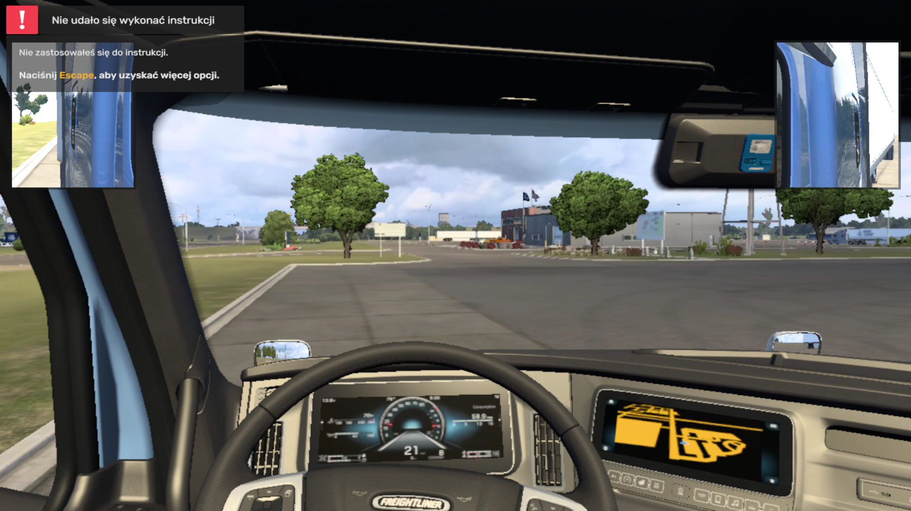

# American Truck Simulator on a remote RTX 3090 Ti (2026-11-04)

Native Linux build of American Truck Simulator (`-rdevice vk`, Vulkan) running on a Ryzen 5 4500U laptop (client, Radeon GPUs disabled
for the game), rendered on the RTX 3090 Ti of the server through the remote Vulkan driver (`gpu-icd` -> `gpu-renderd`, 1 Gb/s link,
H.264 video back to the laptop).

## Result

| | Before | After |
|---|---|---|
| FPS while driving | 2-5 (44-46 in the best scene) | **68-72** (median 68.8, steady 70-71) |
| Synchronous `vkAllocateDescriptorSets` round trips per run | 1 823 326 (228 s of waiting, ~18 ms of a 22 ms frame) | 11 032 (3.7 s) |
| Game survives a full session | no (crashed after about a million descriptor sets) | yes |

## What was wrong (it was not the network)

* The server was almost idle: about 2 million draw commands executed in ~40 s in total, GPU wait ~0.5 ms per frame. The network graph was
  bursty, not saturated.
* The game allocates ~140 descriptor sets per frame. Each was a synchronous round trip (125 us), which is most of a 22 ms frame.
  Fix: the client answers from pool bookkeeping (pool sizes and resets are known exactly), keeps a safety margin of 64 sets/descriptors per
  type near pool exhaustion (the server answers there), and audits every 64th allocation synchronously; any disagreement with the
  server switches the shortcut off for good.
* Crash after ~1 M sets: the server's handle registry is limited to 2^20 entries and descriptor sets were never removed from it on
  `vkResetDescriptorPool`/`vkDestroyDescriptorPool`. Fixed, with a real-Vulkan test (`crates/gpu-renderd/tests/descriptor_pool_registry.rs`).
* Per-command-buffer command recording without the global instance lock, lock-free `vkGetDescriptorEXT`, one memory scan per submitted
  batch and lazy read-back of host-cached memory (page-fault driven, `userfaultfd`) were added the same day; they matter more for
  Cyberpunk 2077 than for this game.

## Files

* `run1-70fps.log`, `run1-70fps-fps.csv`: client statistics of the run above (5-second samples, round-trip ranking per command, lock
  statistics, upload ranking per memory object).
* `renderd-stats.txt`: server-side time per command (decode, execution) for the same session.
* `run2-after-ryzen-reboot.*`: a later run after the laptop was rebooted: median 6 FPS with about 3x the latency per round trip
  (`vkWaitForFences` 4.1 ms vs 1.8 ms, allocations 869 us vs 338 us). The link or the laptop was in a degraded state; not investigated yet.
  It is kept because it shows that this stack is latency-bound: the same code is 10x slower when each round trip costs 3x more.

## How it was run

Steam launch options (client): `VK_DRIVER_FILES=.../gpu_icd_pipelined.json:...radeon_icd.json VK_LOADER_DRIVERS_SELECT=*gpu_icd*
VK_LOADER_DRIVERS_DISABLE=*radeon* GPU_ICD_ADDR=<server>:7979 GPU_ICD_TOKEN_FILE=... GPU_ICD_CODEC=h264 GPU_ICD_STATS=periodic
GPU_ICD_LOG=icd.log %command% -rdevice vk`. Note `VK_LOADER_DRIVERS_SELECT`: Steam can inherit one that hides our driver.
