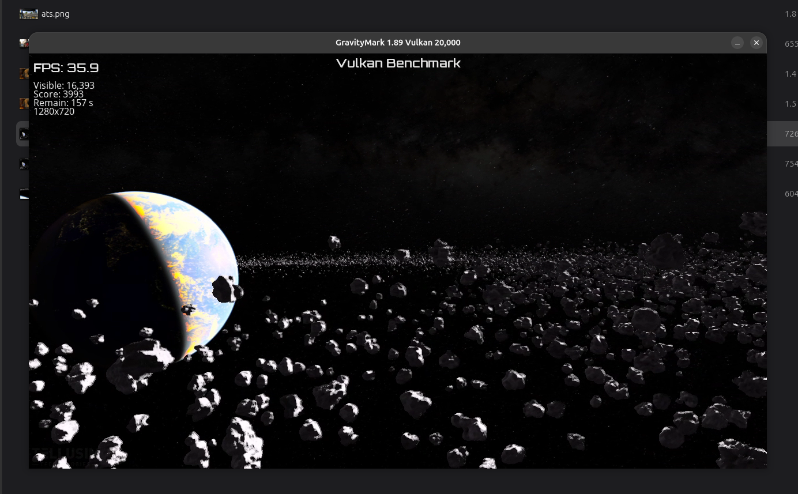

# GravityMark 1.89 (Vulkan) on a remote RTX 3090 Ti (2026-11-05)

Tellusim's GravityMark in windowed Vulkan mode (`-vk -benchmark 1`, 1280x720, vsync off) on the Ryzen 5 4500U laptop, rendered by the RTX 3090 Ti of the
server and returned as H.264. GravityMark draws a field of asteroids with little API traffic (the opposite of Cyberpunk's chatty command streams),
so it exercises the video path and the GPU instead.

*The tester's screenshots of the same session, taken at 18:34, 18:35, 18:40 and 18:42 while the fixes below went in one after another (GravityMark's own overlay, 1280x720, 20 000 asteroids):
[8.1 FPS](Gravity_8_fps.png) after it first started, [17.5 FPS](Gravity_17_5_fps.png) after lazy read-back for uncached memory,
[31 FPS](Gravity_31_fps.png) after allocation speculation, and 35.9 FPS (score 3 993) above. The in-game overlay shows slightly higher numbers than the driver's 5 s averages (30-33), which include the first seconds of each run.*

## Result

| | Before the fixes below | After |
|---|---|---|
| Starts | no ("Initialization error", then a crash) | yes |
| FPS (5 s windows, steady state) | 7-8 once started | **30-33 FPS**, same with 20 000 and with the default asteroid count |
| Frame latency (hand-off to display) | | 17-19 ms average, 23 ms max |

The frame rate is the same for a light and a heavy scene and does not change with `GPU_ICD_MAX_INFLIGHT` 3 / 6 / 10, so the ~32 FPS is a fixed per-frame
cost on the client side, not the GPU (the server renders a frame in ~8 ms). Finding that cost is the next job.

## What had to be fixed to make it run (compatibility gaps this benchmark exposed)

1. `vkEnumeratePhysicalDeviceGroups` was missing (Vulkan 1.1 core): now answered locally, one group per remote card.
2. `VK_KHR_cooperative_matrix` was advertised, but its physical-device query cannot be encoded: no longer advertised.
3. `vkGetPhysicalDeviceImageFormatProperties` (the version without `2`) was a stub that always returned "format not supported": now delegates to the forwarded `2` variant.
4. `vkGetPipelineCacheData` cannot be encoded: answered locally with an empty cache.
5. `vkUpdateDescriptorSets`: the engine leaves the unused pointers of `VkWriteDescriptorSet` uninitialised (legal in Vulkan: only the pointer matching the descriptor type is read);
   our encoder dereferenced every non-null pointer and crashed. The pointers the descriptor type does not use are now zeroed in a copy before encoding.

## What made it 4x faster once running (performance)

* **Lazy read-back also for uncached host-visible memory.** The 8 MB write-combined buffers that the game maps were refreshed from the server after every
  GPU wait (21 ms per request, 18.8 s of a 40 s run on the server); now only the pages the game reads are fetched. 7-8 -> 15-16 FPS.
* **Allocation speculation for pools that list extension descriptor types.** The game's descriptor pools also list a ray-tracing type; that made the whole pool "special", so ~200 descriptor
  set allocations per frame were synchronous round trips. 15-16 -> 30-33 FPS.

## Server clean-up bug found on the way

After a session the server kept 2 GB of VRAM (15 GB after crashed games) because the NVIDIA driver does not free device memory on `vkDestroyDevice` when objects
are still alive. The daemon now frees every allocation of the device first; VRAM returns to 43 MB after the benchmark.

## Files

`run-30fps.log` (driver statistics, 5 s samples, round trips per command, lock statistics), `run-30fps-fps.csv` (FPS series).
